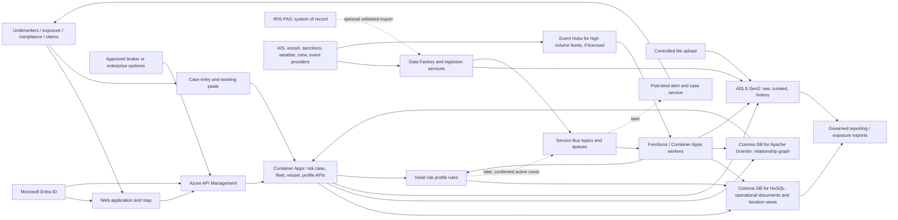

# Marine and Cargo Risk Intelligence Platform — High Level Design

**Status:** Draft for business and architecture review  
**Date:** 22 September 2026  
**Scope:** Marine, cargo/logistics, hull, war and specialist yachts  
**Basis:** `CATS background info.docx`, the user's updated brief, and the current localhost Marine Risk Intelligence proof of concept (POC)

## 1. Purpose and design position

Build an Azure based application whose **first deliverable is an initial, explainable risk profile** for an individual or fleet yacht, marine or cargo risk. An underwriter supplies the risk details and may copy and paste relevant policy terms, conditions and exclusions from IRIS PAS. The first release also maintains a declared fleet schedule and a manually confirmed reference to written fleet cover. External intelligence adds context and data quality indicators. The application supports the underwriting decision and fleet visibility; IRIS remains the policy administration system. **Post-bind alerting remains a target requirement** and starts once active cover and its effective dates have been confirmed in this application.

**IRIS PAS integration constraint:** IRIS PAS is the policy administration system and currently has no available API for this use case. The first release must work without any automated IRIS connection. A controlled file export/import may be added if IRIS can produce a usable extract. Neither a pasted wording nor an imported file is assumed to be a complete or current policy without underwriter confirmation.

The background note supplies business use cases and a preliminary vendor comparison. Its product rankings and suggested vendor combination are **inputs for procurement**, not verified selection decisions or instructions to the application. This design adopts the use cases and keeps provider interfaces replaceable. Pricing changes, sanctions decisions, notices of cancellation (NOC) and war additional premiums (AP) remain controlled business workflows unless separately approved and implemented.

### Outcomes

1. Create and maintain fleet insurance schedules: which vessels are proposed or covered, when each joins or leaves, and how they relate to the IRIS policy reference.
2. Identify and vet vessels, owners, managers, operators and cargo movements for underwriting and compliance.
3. Show the proposed risk's vessel, route and relevant geographic exposures on a map, with observation time and source confidence.
4. Assess specialist yachts using weather exposure **and crew information**, alongside vessel condition and voyage context.
5. Assess marine/cargo across a broader range of factors: carrying vessel quality, cargo type/value, route, ports, transshipment, accumulation, war zones, sanctions and suspicious activity.
6. Use **Cosmos DB for Apache Gremlin from day one** to traverse fleet → member vessel → owner/manager → screening paths and show the evidence in the application.
7. Record the relevant terms, conditions and exclusions as supplied by the underwriter, identify possible risk implications and gaps, and require review of any interpretation.
8. Add actionable **post-bind alerts** when written cover can be reliably activated and maintained; provide an auditable referral and acknowledgement process.
9. Export the risk profile and its evidence for underwriting and future exposure management.
10. Check each proposed vessel against available international marine casualty/incident records and any licensed vessel-linked insurance claims history; show the source, date and match confidence, and refer material findings to an underwriter.

## 2. Scope and requirements

| ID | Requirement | Design response |
|---|---|---|
| R1 | Initial risk profile | Underwriter creates an individual or fleet case with class, assets/shipments, route, dates, value and other available facts. The service returns evidence, risk factors, uncertainty and referral prompts. No bound policy is needed. |
| R2 | Terms, conditions and exclusions | Provide separate paste fields or an attached document for relevant wording, retain the source text and version, and let the underwriter confirm any structured fields derived from it. Missing or ambiguous wording is flagged. |
| R3 | Location and historical tracks | Licensed AIS data supports the initial profile; every position shows observation time and coverage/freshness. Near real-time feeds are a later monitoring need. |
| R4 | Vessel due diligence | Versioned identity, ownership/management/flag/class/port state control (PSC) facts, with prior names and historical changes. |
| R5 | Sanctions and suspicious activity | Initial screening of the proposed interest and associated parties; detect or ingest AIS gaps, dark-fleet indicators and ship-to-ship (STS) transfer findings. Candidate matches go to compliance review. Ongoing screening follows in monitoring. |
| R6 | Yacht risk | Weather history and forecasts, storm exposure, yacht location/itinerary, crew qualifications/complement where contractually relevant, and source confidence. |
| R7 | Cargo and war risk | Shipment/cargo details, insured limits, vessel and voyage legs, ports, storage/transshipment, conflict areas and event footprints; track global exposure against premium. |
| R8 | Fleet cover registration and post-bind monitoring | Day one: underwriter confirms the IRIS policy reference, bound status, effective/expiry dates and covered fleet schedule or imports a validated IRIS export. Later: confirmed active interests join the alerting roster. |
| R9 | Referral and response | Generate vessel summary/referral packs, support Asta or other compliance processes, exposure reports after an incident, and human approval for NOC/AP actions. |
| R10 | Scheduled and ad hoc data imports | Upload files and connect periodic provider extracts with validation, lineage, replay and quarantine. An IRIS export is optional and subject to an agreed format and reconciliation process. |
| R11 | Secure APIs and access | Microsoft Entra ID for workforce and service identity; Azure API Management (APIM) for governed external and internal API access. |
| R12 | Day-one relationship intelligence | Cosmos DB for Apache Gremlin is deployed with the initial application. Fleet and individual profiles perform real graph traversals, show relationship paths and source evidence, and surface graph unavailability as a data gap. |
| R13 | Fleet schedule changes | Add/remove vessels through underwriter entry or a controlled schedule upload. Version membership, dates, declared values and source; distinguish a proposed fleet member from a vessel confirmed under written cover. |
| R14 | Vessel loss-history check | For each proposed vessel, search an agreed international casualty/incident source and any licensed vessel-level claims source by IMO number where available, with reviewed fallback identifiers for yachts. Show matched events, severity, date, source, data coverage and uncertainty in the initial profile; repeat the check when a material new event is received after bind. Do not describe a casualty record as an insurance claim or a missing record as a clean claims history. |

**Out of scope for the first release:** automated policy ingestion from IRIS, automatic binding, portfolio scale post-bind alerting, automatic sanctions clearance, automatic NOC or AP issuance, actuarially calibrated pricing, and proving absence of a vessel from a missing AIS signal. These require integration access, business rules, delegated authority or validated data that are not yet specified.

## 3. Logical architecture

**Hosting choice:** Start with Azure Container Apps for containerised domain APIs and long running workers, and Azure Functions for scheduled, file arrival and message triggered tasks. Keep policy, exposure, risk and alert as *logical* service boundaries; split deployments only when scale, ownership or release cadence warrants it. Container Apps supports APIs, jobs and event driven microservices ([Microsoft documentation](https://learn.microsoft.com/en-us/azure/container-apps/overview)). Use Azure Container Registry and infrastructure as code for deployment.

**Event choice:** In the first release, Azure Functions or Container Apps workers process profile requests and periodic data updates. Service Bus is the future reliable work queue for `CoverConfirmed`, `ExposureChanged`, `IntelligenceUpdated` and `AlertRaised`, with retries, dead letter queues and idempotent consumers. Use Event Hubs only if licensed high volume AIS or other telemetry streams are needed for post-bind alert latency. Azure Data Factory orchestrates periodic imports and backfills ([Data Factory](https://learn.microsoft.com/en-us/azure/data-factory/introduction), [Azure messaging choices](https://learn.microsoft.com/en-us/azure/architecture/guide/technology-choices/messaging)).

## 4. Main data and service responsibilities

| Component | Responsibility |
|---|---|
| Risk case and wording service | Capture proposed risk details, IRIS reference if known, pasted terms/conditions/exclusions, source and author. Keep original wording separate from underwriter confirmed structured fields; version edits and record gaps. IRIS PAS remains authoritative for written policy terms. |
| Fleet schedule service | Create a fleet risk case, add or remove members individually or by validated file, resolve vessel identifiers, record proposed and confirmed membership periods and declared values, and retain each schedule version. Removals close effective membership periods rather than erase history. A confirmed cover projection links to the IRIS policy reference. |
| Vessel and entity service | Resolve IMO, MMSI, call sign and former names; maintain confidence scored identities and time valid owner, manager, operator, flag and fleet relationships. Handle yachts without IMO through multiple identifiers and manual review. |
| Casualty and claims history service | Match the canonical vessel against licensed casualty/incident records and, separately, MCI or licensed insurer claims history. Deduplicate repeated reports of one event, retain source evidence and distinguish confirmed, possible and unresolved matches. |
| Relationship intelligence service | Write risk case, fleet, confirmed cover, vessel, entity and relationship facts into Cosmos DB for Apache Gremlin. Perform bounded fleet and vessel traversals for each initial risk profile and return evidence paths with source, relationship type, valid dates and match confidence for the UI. |
| Cargo and journey service | Represent shipments, cargo type, conveyance, route legs, containers/locations when available, storage, limits, and the periods in which each leg is insured. |
| Data ingestion service | Land source files unchanged; validate schema and licence; normalise units, dates and coordinates; deduplicate; record source/version/retrieval time; quarantine errors and support replay. |
| Risk and screening service | Apply separate versioned yacht, hull, cargo and war rule sets. Store evidence, result, confidence and reasons. Candidate sanctions/behavioural matches are review prompts, not definitive findings. |
| Spatial exposure service | Initially place the proposed asset or voyage against relevant tracks, weather and geofences. Later, join confirmed covered interests to positions for current accumulation and historical peak concurrency. |
| Alert and case service | Later phase: correlate repeated findings, route by severity and class, track owner/status/SLA, request compliance or underwriting review, suppress duplicates and retain evidence of actions. |
| Reporting service | Produce an initial risk profile, vessel summary and source evidence pack. Later add portfolio snapshots, event response reports and exposure exports. |

### Data model and storage

- **Cosmos DB for NoSQL** is the operational store for risk cases, fleet schedule versions and declared values, underwriter confirmed terms, vessel and shipment summaries, latest known locations, risk assessments, manually confirmed cover projections and audit references; later it can store alerts. Its GeoJSON spatial indexing supports point/area queries ([Microsoft documentation](https://learn.microsoft.com/en-us/azure/cosmos-db/how-to-geospatial-index-query)). Select partition keys from actual query and volume tests; likely separate containers by workload rather than one universal container.
- **Cosmos DB for Apache Gremlin is required in the first release.** It is a separate graph API, not an extension added to the NoSQL container, and is the application's **operational relationship store** for fleet membership, cover links and entity traversals. The day-one graph includes `RiskCase`, `Fleet`, `Vessel`, `Organisation`, `ScreeningRecord` and, when cover is manually confirmed, `PolicyReference` vertices. Sourced, time valid edges include `ASSESSES_FLEET` (risk case → fleet), `HAS_MEMBER` (fleet → vessel), `OWNED_BY`, `MANAGED_BY`, `OPERATED_BY`, `LINKED_TO_SCREENING_RECORD`, `COVERS_FLEET` (confirmed policy reference → fleet) and explicit `COVERS_VESSEL` edges for each confirmed covered member. Fleet membership alone never proves cover. The graph is populated by validated fleet schedules and identity/registry/screening imports, with stable IDs and replayable writes; fleet views query Gremlin rather than a copied relationship list. IRIS remains the policy authority, while values and wording remain in NoSQL. Gremlin has feature and distributed transaction limits ([Microsoft documentation](https://learn.microsoft.com/en-us/azure/cosmos-db/gremlin/support)).
- **Graph access pattern:** For a fleet case, start at the known, partition scoped `Fleet` vertex, follow its time valid `HAS_MEMBER` edges to vessels, then bounded outgoing ownership/management paths to organisations and screening records. For a single vessel, resolve IMO/MMSI to a canonical ID and begin there. Return paths with source, validity and confidence; include the confirmed `PolicyReference` path only when bound cover has been reviewed. Partition choice, fleet traversal size, pagination and read/write RU budgets are tested with representative schedules. Azure recommends known partition keys and outgoing traversals for efficient Gremlin queries ([Microsoft partitioning guidance](https://learn.microsoft.com/en-us/azure/cosmos-db/gremlin/partitioning)). A failed graph query is shown as **relationship intelligence unavailable**, not as a clean result.
- **Azure Data Lake Storage Gen2 / Blob Storage** holds immutable raw provider deliveries, normalized history, AIS tracks, weather grids/footprints and generated evidence packs. Retention, access and redistribution follow source licences and legal requirements. Historical tracks should not be stored as unbounded arrays in operational documents.
- Each fact carries **source, source record ID, observed/effective time, ingestion time, validity period, confidence and schema/rule version**. Pasted wording records who supplied it, when, the IRIS reference and whether it has been checked against the issued policy. Preserve original values, allow corrections, and distinguish a missing observation from a negative finding. Canonical IDs link changing MMSIs and names to a vessel without silently overwriting history.
- Casualty events and insurance claims are separate record types. Store event/claim identifiers, vessel match method, event date, type, location, severity, report status and source rights where supplied. Multiple publications about one casualty are grouped under one event with separate citations. Claims amounts or outcomes are shown only when MCI owns them or the licence explicitly permits their use.
- Aggregation counts only active covered interests at the queried time, applies agreed net/gross basis and currency conversion, and avoids double counting the same cargo across vessel, port and storage views. For a period peak, calculate the maximum sum of exposures **concurrent at a point in time**; do not add each asset's individual maximum. Store the valuation basis and FX rates used.

## 5. End to end workflows

### A. Create the initial risk profile

1. The underwriter opens an individual or fleet risk case and enters the minimum structured facts: class, vessel/asset or shipment identifiers, route/territory, proposed dates, value/limit and any relevant crew details. For a fleet, they enter or upload a schedule of vessels with identifiers, declared values and membership dates. The case may carry an IRIS reference but is not treated as bound cover.
2. The underwriter pastes relevant **terms, conditions and exclusions** into labelled fields or attaches the relevant extract. The application preserves the supplied wording verbatim, its provenance and version. It may suggest structured tags such as navigation limits, weather conditions, crew warranties or excluded territories, but the underwriter must confirm them before they drive any rule. Ambiguous or missing wording remains an explicit gap.
3. The profile service resolves fleet members and entity identities, checks each vessel against available casualty/incident history and separately licensed claims history, retrieves other licensed intelligence, **queries Cosmos DB for Apache Gremlin for fleet membership and each vessel's owner/manager/screening paths**, evaluates class specific risk factors and returns an explainable fleet summary plus per-vessel findings, confidence, wording implications, data gaps and referral prompts. A possible casualty/claim match is a review prompt, not proof of fault or insured loss. It does not claim to determine coverage or replace IRIS policy wording.
4. The underwriter can correct inputs and regenerate a versioned profile. The saved output records the inputs, data timestamps, rule version, reviewer and export history.

The profile screen includes a **Fleet and relationship evidence** panel: risk case → fleet → member vessel → owner or manager → linked screening record. It shows the member count, declared value totals by currency, unresolved identifiers, additions/removals, shared owners/managers and per-vessel findings. Selecting a link shows the relationship type, source, date range and confidence. If no sourced path exists, it says “No relationship found in available data”; if the graph or import is stale/unavailable, it shows that condition separately. The paths are returned by live Gremlin queries and their correlation ID is logged with the profile version. Value totals come from the confirmed schedule in NoSQL and are reconciled to graph membership, rather than calculated from graph properties.

### A2. Register written fleet cover (day one); activate monitoring later

After the business is written in IRIS, an authorised user can register the IRIS policy reference, bound status, effective and expiry dates, covered fleet members, insured values and any terms needed for monitoring. This creates a versioned cover projection in NoSQL and `PolicyReference` → `Fleet` / explicitly covered `Vessel` edges in Gremlin. A validated IRIS export may populate those fields, but a human reviews mismatches and changes. Day-one views show proposed members separately from confirmed covered members. Endorsements and cancellations require a repeat update and reconciliation process. In the later alerting phase, only **confirmed active cover** joins the monitoring roster; an unconfirmed quote or stale copy of the terms cannot trigger a coverage specific alert. Registration and subsequent activation record who confirmed the data and when. The roster shows its last reconciliation date and flags overdue review: without timely manual updates or an agreed export, post-bind alerts may be missed or refer to outdated cover.

### B. Import or stream changing intelligence

1. Data Factory schedules vendor extracts and internal uploads. A controlled upload path accepts approved CSV/JSON/Parquet and rejects files failing schema, malware or business validation. A possible IRIS export follows this route only after its format and reconciliation have been agreed. Raw files and manifests are retained for replay.
2. AIS, weather, sanctions, vessel registry, PSC, casualty/incident, permitted claims, crew and geopolitical feeds use source specific adapters. High volume position streams may enter via Event Hubs; lower frequency changes enter via scheduled imports or provider webhooks/APIM.
3. Normalisation resolves identifiers, timestamps, location and units; material changes publish work items to Service Bus. A late or corrected observation can re-evaluate historical exposure and mark prior assessments superseded.
4. Data freshness monitors detect missing feeds. A stale position is labelled **last known**, and a missing AIS track is never treated as proof of absence.

### C. Alert after business is written (later phase)

1. A position, forecast, conflict zone, sanctions or ownership change, crew change, AIS gap or other intelligence update selects **confirmed active insured interests** affected at that event's time.
2. Rule evaluation combines underwriter confirmed, structured policy facts with class specific logic and source quality. Pasted free text alone cannot be used to assert that a condition applies. Examples: yacht entering a storm warning area with inadequate crew evidence; cargo on a newly flagged carrying vessel; war area entry or a newly declared conflict footprint; sanctions ownership path or suspicious STS activity; area aggregation breaching a limit.
3. The case service groups repeat observations into one case per relevant risk/event, applies severity and response SLA, and notifies the appropriate underwriter, exposure manager or compliance team. Failed processing goes to a dead letter queue with monitored replay. Service Bus consumers must remain idempotent ([Microsoft guidance](https://learn.microsoft.com/en-us/azure/service-bus-messaging/service-bus-message-loss-and-duplicates)).
4. The reviewer sees the confirmed cover record and IRIS reference, covered interest, map/time, rule version, source citations, confidence, estimated exposure and recommended action. They acknowledge, investigate, refer, dismiss with reason or escalate. Decisions and notifications are logged.
5. War NOC, AP, sanctions referral and broker communication are generated as **draft actions** for authorised people. Their effective wording, recipients and approvals are governed by policy and legal teams. The platform records whether the action was sent and its outcome.

### D. Event response and accumulation (later phase)

For a conflict, hurricane or other footprint, the exposure service snapshots all intersecting insured interests at the relevant time, with insured value, policy terms, identity and last known position confidence. It outputs map and tabular reports for rapid response, including gross/net exposure and premium where available. Historical peak calculation uses time aligned position and cover intervals; uncertainty from sparse AIS is reported separately.

## 6. Risk profiles

| Profile | Required dimensions | Output and controls |
|---|---|---|
| Fleet insurance | Fleet schedule, vessel identities, member effective dates, declared values, shared owners/managers, individual vessel findings and confirmed IRIS cover reference when written. | Initial fleet summary and per-vessel exceptions from live Gremlin traversals; proposed and confirmed covered members shown separately. Later, monitor only confirmed covered members at each event time. |
| Specialist yacht | Vessel identity/condition, available casualty/incident and permitted claims history, itinerary, seasonal and forecast weather, historical storm encounters, location quality, crew complement, qualifications/certificates and relevant experience; pasted navigation/crew/weather terms where available. | Explainable initial risk indicators, wording gaps and referral prompts; crew PII minimised and restricted. A weather forecast is distinguished from a historical event. |
| Cargo/logistics | Cargo type/sensitivity, value and limit, carrying vessel quality, ownership and sanctions nexus, route/ports, storage and transshipment, accumulation, weather, theft and conflict exposure; pasted cargo/territory exclusions where available. | Initial leg level risk profile and exception list. Later, confirmed policy attachment and voyage dates determine whether a monitoring finding concerns covered business. |
| Hull and marine war | Vessel value/type/age/class/PSC, casualty/incident and permitted claims history, owner/manager/flag history, current route, AIS gaps/STS indicators, high risk area entry and conflict events. | Initial vessel and fleet risk context and human referral. Geographic accumulation and draft AP/NOC workflows follow with post-bind monitoring. |

The current POC's NOAA AIS/HURDAT2 tropical cyclone assessment is a useful **historical yacht weather component** and a pattern for explainable scoring. It is limited to cached US coastal tracks, and its `TC-EXPOSURE-v0.1` score is explicitly not actuarially calibrated. It must not be reused as a live global weather feed or as a cargo/war score without new data and validation.

## 7. Security, governance and operations

- **Identity and APIs:** Entra ID provides workforce sign in, service principals/managed identities and role based access. APIM validates Entra access tokens, applies product/consumer policies, versioning, throttling and audit correlation ([Microsoft APIM policy](https://learn.microsoft.com/en-us/azure/api-management/validate-azure-ad-token-policy)). Separate underwriter, exposure, compliance, claims, administrator and external integration roles. Apply record level controls to restricted policies and crew details.
- **Secrets and network:** Use managed identity where supported, Azure Key Vault for provider credentials, private connectivity to data services, encryption in transit and at rest, and separate dev/test/prod environments. For the Gremlin data-plane connection, use a supported key/connection-string flow, with secrets retrieved securely; do not assume a direct Entra token can authenticate the Gremlin endpoint. Microsoft's Service Connector guidance uses managed identity to retrieve the connection key before connecting ([Microsoft documentation](https://learn.microsoft.com/en-us/azure/service-connector/how-to-integrate-cosmos-gremlin)). Provider egress and allowed destinations need explicit configuration.
- **Data protection:** Define lawful basis, access, retention and deletion for crew and other personal information; collect only fields needed for yacht risk. Restrict sanctions match details and licensed vendor data. Record source licence, permitted users, storage period and onward sharing rights before onboarding a provider.
- **Audit:** Keep immutable source manifests and tamper evident logs of pasted wording, underwriter confirmation, risk input changes, rule versions, profile exports and manual overrides. Add confirmed cover changes and alert decisions when post-bind monitoring is delivered. Capture the exact input snapshot used for a material decision.
- **Reliability:** Monitor ingestion lag, feed freshness, unresolved identities, queue depth, dead letters, rule failures, alert age and notification delivery in Azure Monitor/Application Insights. Define runbooks for provider outages, alert replay, false positives and regional recovery. Use backups and a tested recovery plan.
- **Delivery:** Deploy through infrastructure as code and CI/CD with schema compatibility checks, contract tests for provider adapters, geospatial/aggregation tests and alert scenario tests. Release rules under version control with a review and rollback path.

### Proposed service objectives for validation

| Measure | Initial design target; confirm with business and provider contracts |
|---|---|
| Initial profile | Target an interactive response once required inputs and source data are available; measure representative cases before setting a numeric commitment. |
| Fleet cover registration | Records the underwriter confirmed covered schedule and IRIS reference; the graph and cover view show the update after processing. No automatic bind event is assumed. |
| Monitoring activation, later phase | Starts only for registered and reconciled active cover. |
| High severity alert, later phase | Within 10 minutes of receiving a qualifying streaming event and confirmation that cover is active; dependent on upstream feed latency. |
| Scheduled import | Complete and publish a daily feed within 2 hours of its agreed delivery window. |
| Map freshness | Display actual observation age; do not claim a uniform global “live” position. |
| Availability and recovery | Set RTO/RPO and service availability after dependency and cost review; test recovery before production. |

These are **proposed targets**, not commitments. Validate them using a representative fleet, policy volume, AIS update rate, geofence complexity and vendor licence limits. Procurement must confirm geographic coverage, latency, history, API entitlements and redistribution rights.

## 8. Delivery plan and decisions to make

| Phase | Deliverable |
|---|---|
| 0 — discovery and data contracts | Confirm minimum risk and fleet schedule inputs, IRIS wording format and permitted copy/paste or export process; define class specific profile outputs, referral requirements and vendor rights. Select day-one ownership/management sources and benchmark Gremlin fleet traversal, partitioning and RU cost with representative schedules. |
| 1 — initial risk and fleet cover visibility | Entra/APIM, underwriter case entry and wording paste, fleet schedule entry/upload and versioning, manual IRIS cover registration, vessel identity, yacht weather/crew and marine/cargo factors, Cosmos NoSQL **and Cosmos DB for Apache Gremlin**, source imports, working fleet/member/owner traversal and evidence panel, explainable profile, export and audit. No IRIS API is required. |
| 2 — post-bind alerts | Cover change/reconciliation workflow, optional validated IRIS file import, Service Bus workflow, AIS/weather/event/geofence rules, alert case handling and SLAs. Add current accumulation once insured values are reliable. |
| 3 — deeper intelligence and aggregation | Historical concurrent aggregation, incident response reporting, more complex graph relationship paths, STS/dark activity integration, broker facing outputs and validated pricing inputs. |

**Open decisions:**

1. Which IRIS fields, terms, conditions and exclusions are essential for the initial profile, and can IRIS produce a permitted, reliable export? Until then, the underwriter will enter and confirm them manually.
2. Which marine classes and territories launch first, and what wording tags, risk factors and referral thresholds are required? For a later monitoring phase, who owns alerts and out of hours escalation?
3. Which AIS, registry, sanctions, weather, geopolitical and crew sources can be licensed for persistent storage, API use and reporting? Appendix A profiles the current candidates and overlap; no provider is selected by this HLD.
4. What is the agreed method for gross/net aggregation, currency conversion, cargo movement gaps and overlapping covers once confirmed policies are available?
5. What exact Asta/other compliance referral payload and approval path are required, and which actions may be automated?
6. Which licensed sources provide reliable owner/manager and screening relationships for day-one fleet traversal, and what partition key/RU capacity meets the expected fleet size and update frequency?
7. What is the authoritative fleet schedule format in IRIS, and how will underwriters confirm additions, removals and vessel-specific cover exceptions when there is no API?
8. Does “international claims list” mean IUMI's Major Claims Database, IMO GISIS marine casualties, another named source, or both casualty and insurance claims history? Which vessel-level records and licence rights can MCI actually obtain?

## 9. Acceptance evidence for the first production increment

- An underwriter can create an individual or fleet yacht/cargo risk case without a bound policy, paste terms/conditions/exclusions and obtain an initial, explainable risk profile.
- A fleet schedule upload or manual edit creates versioned `Fleet` → `Vessel` membership edges in Gremlin. The application shows added/removed members, unresolved identifiers, member count and per-vessel findings for the selected effective date.
- After an authorised underwriter registers written cover from IRIS, the graph displays `PolicyReference` → `Fleet` and explicit covered-vessel links; proposed-only members remain clearly separate. A membership change or cover exception updates the corresponding view and audit trail.
- The original pasted wording and any suggested structured interpretation are displayed separately. Only an underwriter confirmed interpretation is used by rules; missing or ambiguous wording is flagged.
- The profile shows vessel/entity matches, weather or route context, source observation times, confidence, data gaps and referral prompts appropriate to the class.
- Each vessel profile displays a casualty/incident history check and any separately available insurance claims history. A known event is linked to its source and matching identifier; an unavailable, unmatched or incomplete source is labelled accordingly, never “no claims”.
- The first release provisions Cosmos DB for Apache Gremlin and loads a sourced fleet → vessel → owner/manager → screening record path. From the application's fleet case, a user can run the profile and see that path, relationship dates/source and the resulting review prompt. Changing a graph edge or re-running a corrected import changes the displayed result; a disconnected or stale graph produces an explicit data-gap state. A hardcoded example or NoSQL-only lookup does not pass this check.
- A vessel/party sanctions candidate follows a compliance referral path and cannot be silently marked cleared by the matching rule.
- The saved profile can be regenerated after an input correction, retaining previous versions, source versions, rule version and reviewer action.
- A missing provider feed raises an operational alert; business users see that affected profile data is stale.

**Later monitoring acceptance:** a qualifying event for a registered, confirmed covered fleet member produces one evidence backed alert during the effective policy period; a proposed-only or removed member does not produce a coverage specific alert. An endorsement or cancellation updates the roster, and duplicate event replay does not duplicate the case. Portfolio reports reconcile to confirmed cover and show location uncertainty.

## Appendix A — Candidate data sources and overlap

**Assessment date:** 22 September 2026. This profiles public product information and the sources already used by the POC. It does not establish MCI's subscription, API entitlement, data licence, coverage or service levels. Before any production import, obtain the relevant contract and a sample extract for the exact product/module.

### A1. Sources identified by the project

| Source | Verified public capability | Fit for this application | Access and decision |
|---|---|---|---|
| [JWLA.ai](https://jwla.ai/) | Interactive Joint War Committee (JWC) listed-area and IBF/ITF/IWL map; fleet entry, zone alerts, route assessment and estimated AP/crew cost features are visible on the site. | Useful war-risk reference and workflow comparison for fleet geofences, pre-entry warnings and route context. | **Candidate, not yet an ingestion source.** A public machine-readable API, bulk-use rights, source latency and alert terms have not been verified. Request product documentation and rights before connecting it. Treat its AI conclusions and AP estimates as review aids, not policy terms or authoritative rates. [Site](https://jwla.ai/); [LMA listed areas](https://lmalloyds.com/specialist-areas/underwriting/listed-areas/). |
| [Equasis](https://www.equasis.org/EquasisWeb/public/HomePage) | Free registered, ship-by-ship access to merchant-vessel identity, owner/manager, class, PSC and inspection history; its stated fleet scope is merchant ships over 100 GT and fishing vessels. | Useful **manual** due-diligence cross-check for commercial carrying vessels. Coverage of specialist pleasure yachts is uncertain. | **Do not use as an automated feed or seed the Gremlin graph from website data without written permission.** Equasis says it has no extraction API and prohibits bulk download or storing website information in a retrieval system without permission. Obtain comparable licensed fields from an approved provider for the application. [Equasis help](https://www.equasis.org/EquasisWeb/public/Moa?P_MOA=help&fs=About); [FAQ](https://www.equasis.org/EquasisWeb/Static/MOA/FAQ/faq.html); [conditions](https://www.equasis.org/EquasisWeb/public/ConditionsRegistration?fs=About). |
| [Clarksons Research](https://www.clarksons.com/research/) | World Fleet Register and Sea/net cover vessel/company information, tracking and movement/deployment data; Shipping Intelligence Network covers shipping market and trade intelligence. Clarksons advertises an API Portal, but products and fields depend on subscription. | **Primary commercial candidate** for canonical commercial-vessel records, company/fleet links, AIS positions and historical movements; potentially feeds Gremlin vessel/organisation edges and the map. | Obtain a module-by-module field list, API sample, update cadence, coverage and redistribution/storage terms. Confirm yacht/no-IMO coverage, ownership history, PSC, sanctions, zone and weather fields instead of assuming they are included. Confirm the provenance of any data Clarksons obtains from another provider. [Research](https://www.clarksons.com/research/); [shipping and trade products](https://www.clarksons.com/research/shipping-trade/). |
| [NOAA](https://www.noaa.gov/) | NHC HURDAT2 provides **post-analysis historical** tropical-cyclone tracks; NHC also publishes advisories/GIS data. NOAA/BOEM/USCG MarineCadastre provides U.S. vessel-traffic AIS products. NOAA NCEI IBTrACS combines global historical cyclone tracks. | Retain the POC's U.S. historical storm/AIS evidence and extend historical cyclone comparison globally with IBTrACS where appropriate. Use an operational forecast/advisory feed separately for alerts. | NOAA vessel-traffic products are not a global live AIS subscription; HURDAT2 and IBTrACS are historical best tracks, not current forecasts. Record dataset release and observation time. [NHC archive](https://www.nhc.noaa.gov/data/); [MarineCadastre vessel traffic](https://coast.noaa.gov/digitalcoast/data/vesseltraffic.html); [IBTrACS](https://www.ncei.noaa.gov/products/international-best-track-archive). |
| Other weather services | [ECMWF Open Data](https://www.ecmwf.int/en/forecasts/datasets/open-data) offers a global forecast subset with a short rolling archive; [Met Office Weather DataHub](https://www.metoffice.gov.uk/services/data/met-office-weather-datahub) offers API products including global spot forecasts; [Copernicus Marine](https://data.marine.copernicus.eu/product/GLOBAL_ANALYSISFORECAST_WAV_001_027/services) offers global wave analysis/forecast data access. | Evaluate for global yacht route/seasonal weather and later forecast-triggered alerts. An atmosphere source and marine wave source may both be needed. | Choose products against required geography, variables, forecast horizon, update rate and commercial-use terms. Do not treat model forecasts as observed conditions or as a complete weather warning service. |

**Identity note for yachts:** The IMO identification scheme exempts pleasure yachts, although some yachts may still have IMO numbers. Fleet identity resolution must also support MMSI, call sign, flag registration and underwriter-supplied identifiers; no IMO match is a data gap rather than proof that a yacht is absent. [IMO identification scheme](https://www.imo.org/en/ourwork/iiis/pages/imo-identification-number-schemes.aspx).

### A2. Additional sources needed for the stated use cases

| Source | Why add it | Boundary |
|---|---|---|
| [Lloyd's Market Association JWC listed areas](https://lmalloyds.com/specialist-areas/underwriting/listed-areas/) | Primary publication against which a JWLA.ai war-zone view and our versioned geofences can be checked. The LMA page identifies the current listed-area circular. | A listed area is a risk/notification input; the JWC does not set an insurer's AP rate. Confirm rights and accurately digitise/version any polygons before automated geofencing. |
| [UK Sanctions List](https://www.gov.uk/government/publications/the-uk-sanctions-list) and [US OFAC Sanctions List Service](https://ofac.treasury.gov/sanctions-list-service) | Official downloadable designations, including relevant people, entities and ships/vessels, for a first-party screening layer and graph-linked candidate matches. | Match results require compliance review, ownership/control analysis and applicable-jurisdiction decisions. The UK Sanctions List replaced the former OFSI consolidated list as the current UK designation source in 2026. |
| IRIS PAS extracts and underwriter-supplied documents | Only source of MCI's insured fleet schedule, effective cover, values, terms/exclusions and yacht crew evidence for this design. | Start with underwriter entry/paste and controlled schedule upload. Any IRIS export must be agreed and reconciled; vendor intelligence cannot infer what MCI has actually insured. |
| [IMO GISIS Marine Casualties and Incidents](https://gisis.imo.org/Public/Default.aspx) | Official international casualty/incident and investigation-report source for a vessel history check. [IMO describes searchable public reports](https://www.imo.org/en/ourwork/iiis/pages/marine-safety-investigation-reports.aspx). | Public search requires an IMO web account; no public API or bulk-ingestion entitlement has been established. Use as a manual verification source until permitted machine access is confirmed. Reporting gaps mean no result cannot prove no casualty. |
| [IUMI Major Claims Database](https://iumi.com/statistics/major-claims-database-2025/) | Aggregate hull and cargo major-loss trends can inform benchmarks and research. | Published outputs are analyses, not a verified vessel-level search/API. Do not represent an IUMI statistics check as clearance of a vessel's insurance claims history; ask IUMI about any licensed detailed access. |
| [Commercial casualty feeds](https://www.marketplace.spglobal.com/en/datasets/maritime-events-%28276%29) | A licensed event dataset can support repeatable IMO-number matching and later new-event monitoring. S&P Global advertises a maritime events feed; [Datalastic documents a casualty API and bulk report](https://docs.datalastic.com/). | Compare coverage, historical depth, yacht/no-IMO matching, event verification, latency, API/bulk rights, storage and cost with the existing Clarksons contract before selection. These describe casualties/incidents, not necessarily insurance claims. |

### A3. Clarksons overlap and proposed source allocation

| Data need | Likely lead | Overlap or gap to resolve |
|---|---|---|
| Vessel identity, commercial ownership, fleet affiliation, movements | Clarksons WFR/Sea/net **if contracted fields confirm coverage** | Equasis is a manual cross-check, not an ingestion fallback. Test a sample fleet, including yachts, name/flag changes and missing IMO cases. |
| Vessel casualty/incident history and insurance claims | IMO GISIS for manual official cross-check; a licensed casualty feed for automated vessel checks; MCI-owned or separately licensed claims records for actual claims history | Check whether Clarksons has a contracted casualty product before buying another feed. IUMI's published Major Claims Database is aggregate analysis and does not establish vessel-level lookup rights. |
| Live/near-real-time positions | Clarksons Sea/net **if licensed update rate meets the alert target** | NOAA MarineCadastre supports U.S. historical analysis. JWLA.ai displays traffic/zone status, but its feed and reuse rights are unverified. |
| War listed areas and zone crossing | LMA JWC publication for the source circular; JWLA.ai as a possible monitoring/workflow product | Clarksons zone/geofence capability has not been verified. Even if included, confirm the exact circular version and polygon provenance. |
| Yacht and cargo weather | NOAA for historical U.S. cyclone work; evaluate ECMWF/Met Office and Copernicus Marine for global forecasts/waves | No verified Clarksons weather entitlement or crew-qualification feed. Keep these as separate sourcing decisions. |
| Sanctions designations and relationship screening | UK Sanctions List/OFAC; a licensed entity-resolution or maritime-screening provider if needed | Clarksons may supply company relationships, but the scope of sanctions screening and ownership/control data must be confirmed. JWLA.ai war-zone intelligence does not substitute for sanctions screening. |
| Written cover, values, exclusions and crew documents | IRIS PAS and underwriter confirmation | No external vessel-data platform is authoritative for MCI's policy or crew evidence. |

**Sourcing decision:** Evaluate Clarksons first for a licensed commercial-vessel/AIS foundation, then buy or build only the missing capabilities. “Available in Clarksons” must mean a field is present in **MCI's contracted module and permitted for storage in Cosmos DB and use in the application**. Do not assume that Clarksons includes Equasis, JWLA.ai, NOAA or weather products merely because their functions overlap.

### A4. Data onboarding checks

For each source, record the product/module, named owner, permitted use and redistribution, API or file access, yacht and geographic coverage, IMO/MMSI match rate, fields for owner/manager/PSC/sanctions/weather, update and backfill cadence, retention rights, outage process, price and sample-data validation result. Each imported record or Gremlin edge must carry provider, dataset/version, source record ID, observed/effective time and ingestion time. Unlicensed or stale sources must appear as a profile data gap; they must never silently produce a clean risk result.
