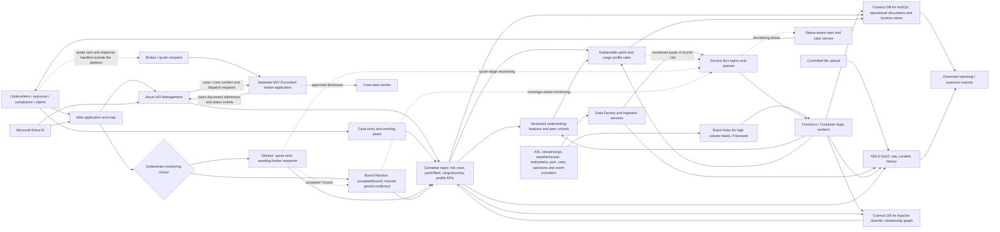

# Marine and Cargo Risk Intelligence Platform — High Level Design

**Status:** Draft for business and architecture review  
**Date:** 2 October 2026  
**Scope:** Initial service for specialist yachts of 30 metres and above **and cargo/logistics risks**, including relevant hull, war, geographic and accumulation factors  
**Basis:** `The CAT Tool - Requirements.docx`, `CATS background info.docx`, the agreed `Monitor` / `Bound Monitor` workflow, and the current localhost Marine Risk Intelligence proof of concept (POC)

## 1. Purpose and design position

Build an Azure based application whose **first deliverable is an initial, explainable risk profile** for a specialist yacht or cargo/logistics risk. An underwriter supplies the yacht/fleet or cargo/shipment details and requests a risk summary. The application presents the summary together with **all available, licensed and permitted supporting data**, its sources, observation times, confidence, peer context where defensible and explicit data gaps. The underwriter may then select **Monitor** when the quote has gone to the broker and no response has been received, or **Bound Monitor** when the quote has been accepted/bound. `Monitor` produces quote-stage risk-change notifications that do not imply cover. `Bound Monitor` produces coverage-aware alerts only during the manually confirmed insured period. IRIS/Websure remains the policy administration system but is not integrated with this application.

**Policy-system integration constraint:** There will be no API, event, file or other system integration with IRIS/Websure for this use case. Authorised users manually enter and confirm the policy reference, quote status, bound status, effective and expiry dates, covered interests, values and monitoring terms in this application. Pasted wording or manually entered policy information is not assumed to be complete or current without underwriter confirmation. The transition from `Monitor` to `Bound Monitor`, and all subsequent endorsements, cancellations and expiry changes, therefore depend on a controlled manual confirmation and reconciliation process.

The background note supplies business use cases and a preliminary vendor comparison. Its product rankings and suggested vendor combination are **inputs for procurement**, not verified selection decisions or instructions to the application. This design adopts the use cases and keeps provider interfaces replaceable. Pricing changes, sanctions decisions, notices of cancellation (NOC) and war additional premiums (AP) remain controlled business workflows unless separately approved and implemented.

### Outcomes

1. Create and maintain fleet insurance schedules: which vessels are proposed or covered, when each joins or leaves, and how they relate to the IRIS/Websure policy reference.
2. Identify and vet yachts, carrying vessels, owners, managers, operators, captains/crew where relevant, shipments and cargo movements for underwriting and compliance.
3. Show the proposed yacht or cargo journey, route and relevant geographic exposures on a map, with observation time and source confidence.
4. Assess specialist yachts using historical AIS behaviour, weather, waves/ocean, cyclone exposure, navigation/grounding context and **captain/crew information**, alongside vessel condition and voyage context.
5. Assess cargo/logistics using carrying-vessel quality and behaviour, cargo type/value/sensitivity, voyage legs, ports, storage/transshipment, accumulation, weather, war zones, sanctions and suspicious activity.
6. Use **Cosmos DB for Apache Gremlin from day one** to traverse both fleet → member vessel → owner/manager/screening paths and cargo case → shipment/journey leg → carrying vessel/port/entity paths, and show the sourced evidence in the application.
7. Record the relevant terms, conditions and exclusions as supplied by the underwriter, identify possible risk implications and gaps, and require review of any interpretation.
8. Let the underwriter select **Monitor** for a quote awaiting a broker response or **Bound Monitor** for accepted/bound business. Provide actionable, auditable alerts appropriate to the selected state and automatically enforce the confirmed insured period for `Bound Monitor`.
9. Export the risk profile and its evidence for underwriting and future exposure management.
10. Check each proposed vessel against available international marine casualty/incident records and any licensed vessel-linked insurance claims history; show the source, date and match confidence, and refer material findings to an underwriter.
11. Compare a yacht, carrying vessel or journey with an appropriate peer cohort where the available data supports a fair comparison; always show the peer definition, period and coverage.
12. Use reliable MCI claims and exposure history later to test whether proposed indicators are associated with loss, subject to actuarial review; do not assume a behaviour is adverse or turn correlation into an automatic underwriting decision.
13. Integrate with the separate MCI Document Intake application so crew CVs and qualification certificates received through a shared mailbox appear as controlled document references on the correct yacht case and can be submitted for reviewed hand-off to an approved crew-data provider.

## 2. Scope and requirements

| ID | Requirement | Design response |
|---|---|---|
| R1 | Initial risk profile | Underwriter creates an individual or fleet case with class, vessel/assets/shipments, route, dates, value and other available facts. The service returns an explainable risk summary and presents all available supporting data used or retrieved, with source, observation time, confidence, coverage limitations, uncertainty and referral prompts. No bound policy is needed. |
| R2 | Terms, conditions and exclusions | Provide separate paste fields or an attached document for relevant wording, retain the source text and version, and let the underwriter confirm any structured fields derived from it. Missing or ambiguous wording is flagged. |
| R3 | Location, historical tracks and behaviour | Licensed AIS data supports the initial profile. Derive distance travelled, days underway, seasonal use, speed distributions, night operation, anchoring/port visits, route change, manoeuvre indicators and visible AIS gaps where the source supports them. Support 12/24/36/60-month windows where licensed, with five years as the initial historical target rather than an assumed guarantee. Every result shows observation period, coverage and freshness. Near-real-time feeds support monitoring. |
| R4 | Vessel due diligence | Versioned identity, ownership/management/flag/class/port state control (PSC) facts, with prior names and historical changes. |
| R5 | Sanctions and suspicious activity | Initial screening of the proposed interest and associated parties; detect or ingest AIS gaps, dark-fleet indicators and ship-to-ship (STS) transfer findings. Candidate matches go to compliance review. Ongoing screening follows in monitoring. |
| R6 | Yacht risk | Vessel and AIS behaviour, weather history/forecasts, waves/ocean conditions, tropical-cyclone exposure, bathymetry/grounding context, yacht itinerary, and captain/crew qualifications and experience where relevant, all with source confidence and data limitations. |
| R7 | Cargo and war risk | Shipment/cargo type, value and sensitivity, carrying-vessel quality/behaviour, voyage legs, ports, storage/transshipment, weather/ocean conditions, conflict areas and event footprints; track insured accumulation separately from quote-stage pipeline. |
| R8 | Monitoring selection and lifecycle | After reviewing the risk summary and supporting data, an underwriter selects `Monitor` for a quote sent to the broker and awaiting response, or `Bound Monitor` for accepted/bound business. `Monitor` generates quote-stage risk-change alerts and never implies cover. `Bound Monitor` requires manually confirmed policy reference, effective/expiry dates and covered interests, and generates coverage-aware alerts only during that insured period. `Monitor` can transition to `Bound Monitor`; either mode can be stopped with an auditable reason. There is no policy-system integration. |
| R9 | Referral and response | Generate vessel summary/referral packs, support Asta or other compliance processes, exposure reports after an incident, and human approval for NOC/AP actions. |
| R10 | Scheduled and ad hoc data imports | Upload files and connect periodic external-intelligence provider extracts with validation, lineage, replay and quarantine. This path does not accept IRIS/Websure policy exports. |
| R11 | Secure APIs and access | Microsoft Entra ID for workforce and service identity; Azure API Management (APIM) for governed external and internal API access. |
| R12 | Day-one relationship intelligence | Cosmos DB for Apache Gremlin is deployed with the initial application. Yacht/fleet and cargo profiles perform real graph traversals, show relationship paths and source evidence, and surface graph unavailability as a data gap. Initial paths cover fleet/vessel/owner-manager/screening and cargo case/shipment/journey leg/carrying vessel/port/entity relationships. |
| R13 | Fleet schedule changes | Add/remove vessels through underwriter entry or a controlled schedule upload. Version membership, dates, declared values and source; distinguish a proposed fleet member from a vessel confirmed under written cover. |
| R14 | Vessel loss-history check | For each proposed vessel, search an agreed international casualty/incident source and any licensed vessel-level claims source by IMO number where available, with reviewed fallback identifiers for yachts. Show matched events, severity, date, source, data coverage and uncertainty in the initial profile; repeat the check when a material new event is received while the case is in `Monitor` or `Bound Monitor`. Do not describe a casualty record as an insurance claim or a missing record as a clean claims history. |
| R15 | Explainable indicators and peer comparison | Present domain-level indicators with their underlying observations, units, period, source and rule version. Compare with an appropriate yacht, carrying-vessel or journey cohort only when the cohort and coverage are sufficient; show the cohort definition and never present an unexplained composite score as an underwriting decision. Candidate yacht cohorts may use length bands from 30–39m through 100m+, then refine by tonnage, age, construction, private/charter use and geography. |
| R16 | Navigation and grounding context | Match tracks to licensed bathymetry/hydrographic context to derive shallow-water, close-coastal, anchoring-depth and potential safe-harbour indicators. Treat global bathymetry as underwriting context, never as navigation-grade advice. |
| R17 | Captain and crew evidence | Model the captain separately from the yacht and record relevant certificate/CoC, STCW level, tonnage and area limits, flag recognition, endorsements, medical validity and comparable experience where supplied and lawfully used. Verification status, source and expiry must be visible. |
| R18 | Claims calibration — later | Where MCI has lawful, reliable claims and exposure history, test whether yacht/carrying-vessel behaviour, weather/ocean exposure, captain characteristics, cargo/journey features and geography are associated with frequency or severity. Keep experimental results versioned, reviewed and separate from production underwriting rules until actuarially validated and approved. |
| R19 | Document Intake integration | Integrate with the separate MCI Document Intake application. Create an intake reference for the yacht case, receive document-ready/status events, display authorised document references, supply or confirm case and crew-person context, and request reviewed provider dispatch. The CAT application does not own mailbox access, attachment extraction, malware scanning, document storage or the generic provider-delivery framework. |

**Out of scope for the first release:** automatic binding, automatic sanctions clearance, automatic NOC or AP issuance, actuarially calibrated pricing, and proving absence of a vessel from a missing AIS signal. Any API, file or event integration with IRIS/Websure is outside the target design, not merely deferred. `Monitor` and `Bound Monitor` are required workflow states, although monitoring throughput, event latency and portfolio-scale aggregation remain subject to the phased delivery plan and licensed data feeds.

## 3. Logical architecture

**Hosting choice:** Start with Azure Container Apps for containerised domain APIs and long running workers, and Azure Functions for scheduled, file arrival and message triggered tasks. Keep policy, exposure, risk and alert as *logical* service boundaries; split deployments only when scale, ownership or release cadence warrants it. Container Apps supports APIs, jobs and event driven microservices ([Microsoft documentation](https://learn.microsoft.com/en-us/azure/container-apps/overview)). Use Azure Container Registry and infrastructure as code for deployment.

**Event choice:** In the first release, Azure Functions or Container Apps workers process profile requests and periodic data updates. Service Bus is the reliable work queue for `QuoteMonitoringStarted`, `BoundMonitoringStarted`, `MonitoringStopped`, `ExposureChanged`, `IntelligenceUpdated` and `AlertRaised`, with retries, dead letter queues and idempotent consumers. Use Event Hubs only if licensed high volume AIS or other telemetry streams are needed for monitoring latency. Azure Data Factory orchestrates periodic imports and backfills ([Data Factory](https://learn.microsoft.com/en-us/azure/data-factory/introduction), [Azure messaging choices](https://learn.microsoft.com/en-us/azure/architecture/guide/technology-choices/messaging)).

## 4. Main data and service responsibilities

| Component | Responsibility |
|---|---|
| Risk case and wording service | Capture proposed risk details, IRIS/Websure reference if known, pasted terms/conditions/exclusions, source and author. Keep original wording separate from underwriter confirmed structured fields; version edits and record gaps. IRIS/Websure remains authoritative for written policy terms, but it is not integrated with this application. |
| Fleet schedule service | Create a fleet risk case, add or remove members individually or by validated file, resolve vessel identifiers, record proposed and confirmed membership periods and declared values, and retain each schedule version. Removals close effective membership periods rather than erase history. A confirmed cover projection links to the IRIS/Websure policy reference. |
| Monitoring state service | Record the underwriter's `Monitor` or `Bound Monitor` selection, reason, timestamp and effective status. `Monitor` means quote sent and awaiting a broker response; `Bound Monitor` requires manually confirmed cover and insured dates. Support an audited `Monitor` → `Bound Monitor` transition and stop reasons including declined, withdrawn, quote expired, cancelled and cover expired. |
| Vessel and entity service | Resolve IMO, MMSI, call sign and former names; maintain confidence scored identities and time valid owner, manager, operator, flag and fleet relationships. Handle yachts without IMO through multiple identifiers and manual review. |
| Yacht behaviour and navigation service | Calculate versioned AIS behaviour features such as distance, days underway, seasonal use, speed distributions, night operation, anchoring/port visits, route change and visible gaps. Join licensed bathymetry/hydrographic context for shallow-water and grounding indicators without presenting navigation advice. |
| Captain and crew service | Maintain captain/crew evidence separately from the yacht, including supplied qualifications, limitations, recognition, validity and experience. Record verification source/status and enforce restricted access, minimisation and retention. |
| Document Intake integration | Create and resolve yacht-case intake references; consume clean-document and status events from the separate MCI-wide application; retain opaque document IDs rather than bytes; display authorised content through its API; confirm crew-person context; and request provider dispatch. Detailed design is in [MCI Document Intake Application — HLD](MCI_DOCUMENT_INTAKE_HLD.md). |
| Casualty and claims history service | Match the canonical vessel against licensed casualty/incident records and, separately, MCI or licensed insurer claims history. Deduplicate repeated reports of one event, retain source evidence and distinguish confirmed, possible and unresolved matches. |
| Relationship intelligence service | Write yacht/fleet and cargo case, shipment, journey, port, confirmed cover, vessel, captain, organisation, incident/claim reference, screening and relationship facts into Cosmos DB for Apache Gremlin. Perform bounded traversals for each initial profile and return evidence paths with source, relationship type, valid dates and match confidence for the UI. |
| Cargo and journey service | Represent shipments, cargo type/value/sensitivity, carrying vessel, voyage legs, ports, containers/locations when available, storage, transshipment, limits, expected/actual dates, movement gaps and the periods in which each leg is insured. |
| Data ingestion service | Land source files unchanged; validate schema and licence; normalise units, dates and coordinates; deduplicate; record source/version/retrieval time; quarantine errors and support replay. |
| Underwriting feature and peer service | Store versioned calculated features and cohort definitions; return domain-level indicators and factual peer comparisons with units, observation period, coverage and source lineage. Do not emit an unexplained underwriting decision or use a cohort that fails minimum coverage/size rules. |
| Risk and screening service | Apply separate versioned yacht, hull, cargo and war rule sets. Store evidence, result, confidence and reasons. Candidate sanctions/behavioural matches are review prompts, not definitive findings. |
| Spatial exposure service | Place the proposed asset or voyage against relevant tracks, weather and geofences. In `Monitor`, report quote-stage changes without treating the interest as insured. In `Bound Monitor`, join confirmed covered interests to positions during the insured period for current accumulation and historical peak concurrency. |
| Alert and case service | Correlate repeated findings, label every alert with `Monitor` or `Bound Monitor`, route by severity and class, track owner/status/SLA, request compliance or underwriting review, suppress duplicates and retain evidence of actions. Only `Bound Monitor` alerts may be coverage-specific. |
| Reporting service | Produce yacht and cargo risk summaries, vessel/journey views and a view/export of all available supporting data with source, time, confidence, peer definition and gaps. Later add portfolio snapshots, event response reports and exposure exports. |

### Data model and storage

- **Cosmos DB for NoSQL** is the operational store for risk cases, fleet schedule and cargo-journey versions, declared values, underwriter confirmed terms, vessel/shipment summaries, latest known locations, versioned underwriting features and cohort definitions, risk assessments, monitoring-state history, manually confirmed cover projections, alerts/cases and audit references. A monitoring-state record contains `mode` (`Monitor` or `BoundMonitor`), status, selected by/at, quote response deadline where used, effective/expiry dates for bound cover, stop reason and the profile version on which the choice was made. Its GeoJSON spatial indexing supports point/area queries ([Microsoft documentation](https://learn.microsoft.com/en-us/azure/cosmos-db/how-to-geospatial-index-query)). Keep the feature store as a logical boundary; it may begin as dedicated Cosmos containers and curated lake tables rather than a new technology. Select partition keys from actual query and volume tests.
- **Cosmos DB for Apache Gremlin is required in the first release.** It is a separate graph API, not an extension added to the NoSQL container, and is the application's **operational relationship store** for yacht/fleet and cargo relationships, cover links and entity traversals. The initial graph includes `RiskCase`, `Fleet`, `Shipment`, `JourneyLeg`, `Vessel`, `Port`, `Organisation`, `Captain`, `ScreeningRecord` and, when cover is manually confirmed, `PolicyReference` vertices; incident and claim references may be linked where rights permit. Sourced, time-valid edges include fleet membership, shipment/journey conveyance, port/storage/transshipment, captain assignment, ownership/management/operation, screening links and explicit cover links. Fleet membership, shipment association or external movement data alone never proves cover. IRIS/Websure remains the policy authority, while values and wording remain in NoSQL. Gremlin feature and transaction limits still apply ([Microsoft documentation](https://learn.microsoft.com/en-us/azure/cosmos-db/gremlin/support)).
- **Graph access pattern:** For a fleet case, start at the partition-scoped `Fleet`, follow time-valid member edges to vessels, then bounded ownership/management/captain/screening paths. For a cargo case, start at the known `Shipment`, follow ordered `JourneyLeg` edges to carrying vessels, ports, storage/transshipment locations and connected organisations/screening records. For a single yacht or carrying vessel, resolve IMO/MMSI or reviewed fallback identifiers and begin there. Return paths with source, validity and confidence; include confirmed `PolicyReference` cover paths only after underwriter review. Test partition choice, journey/fleet traversal size, pagination and RU budgets with representative yacht and cargo cases. A failed graph query is shown as **relationship intelligence unavailable**, not as a clean result.
- **Azure Data Lake Storage Gen2 / Blob Storage** holds immutable raw provider deliveries, normalised history, AIS tracks, cargo/journey records, weather/ocean grids, cyclone and event footprints, bathymetry/hydrographic context and generated evidence packs. Crew attachments are held by the separate MCI Document Intake application; CAT stores only opaque document IDs, permitted metadata and business-status projections, not attachment bytes. Retention, access and redistribution follow source licences, purpose and legal requirements. Historical tracks should not be stored as unbounded arrays in operational documents.
- Each fact carries **source, source record ID, observed/effective time, ingestion time, validity period, confidence and schema/rule version**. Pasted wording records who supplied it, when, the IRIS/Websure reference and whether it has been checked against the issued policy. Preserve original values, allow corrections, and distinguish a missing observation from a negative finding. Canonical IDs link changing MMSIs and names to a vessel without silently overwriting history.
- Casualty events and insurance claims are separate record types. Store event/claim identifiers, vessel match method, event date, type, location, severity, report status and source rights where supplied. Multiple publications about one casualty are grouped under one event with separate citations. Claims amounts or outcomes are shown only when MCI owns them or the licence explicitly permits their use.
- Aggregation counts only active covered interests at the queried time, applies agreed net/gross basis and currency conversion, and avoids double counting the same cargo across vessel, port and storage views. For a period peak, calculate the maximum sum of exposures **concurrent at a point in time**; do not add each asset's individual maximum. Store the valuation basis and FX rates used.

## 5. End to end workflows

### A. Create the initial risk profile

1. The underwriter opens a specialist-yacht or cargo/logistics risk case. Yacht inputs include vessel/fleet identifiers, itinerary/territory, proposed dates, value/limit and relevant captain/crew details. Cargo inputs include cargo type/value/sensitivity, shipment reference, carrying-vessel identifiers, route and ordered voyage legs, ports, storage/transshipment, proposed dates and limits. A fleet schedule may be uploaded with identifiers, values and membership dates. The case may carry an IRIS/Websure reference but is not treated as bound cover.
2. The underwriter may optionally paste relevant **terms, conditions and exclusions** into labelled fields or attach an extract. This is not required to obtain the initial risk summary. The application preserves supplied wording verbatim with its provenance/version and may suggest structured tags, but an underwriter must confirm them before they drive any rule. Ambiguous, missing or unreviewed wording remains an explicit gap.
3. The profile service resolves vessels, shipments, journey legs and connected entities; checks each yacht or carrying vessel against available casualty/incident history and separately licensed claims history; calculates permitted AIS behaviour, weather/ocean/cyclone and navigation features; retrieves cargo, port and other licensed intelligence; **queries Cosmos DB for Apache Gremlin for both yacht/fleet and cargo journey relationship paths**; and evaluates class-specific rules. It returns an explainable yacht or cargo risk summary plus all available supporting data used or retrieved, domain indicators, defensible peer comparisons, per-vessel or per-leg findings, observation/retrieval times, confidence, coverage limitations, explicit data gaps and referral prompts. A possible casualty/claim or sanctions match is a review prompt, not proof of fault, insured loss or breach.
4. The underwriter reviews the summary and can expand or export the complete supporting-data view, correct inputs and regenerate a versioned profile. The saved output records the inputs, data timestamps, rule version, reviewer and export history.
5. From the reviewed profile, the underwriter may select `Monitor` or `Bound Monitor`. The selection is always attached to the exact profile and yacht/fleet schedule or cargo-journey version reviewed.

The profile screen includes relationship evidence appropriate to the class. The **Yacht/fleet panel** shows risk case → fleet/member yacht → owner, manager or captain → linked screening record, along with member counts, values, unresolved identifiers and per-yacht findings. The **Cargo panel** shows risk case → shipment → ordered journey leg → carrying vessel / port / storage or transshipment location → connected organisation/screening record, along with cargo values, movement gaps and per-leg findings. Selecting a link shows its source, validity dates and confidence. If no sourced path exists, the UI says so; if the graph or import is stale/unavailable, it shows that condition separately. Paths come from live Gremlin queries and their correlation IDs are logged with the profile version. Values remain authoritative in the confirmed NoSQL schedule/journey record and are reconciled to graph relationships rather than calculated from graph properties.

### A1. Receive crew documents by email

1. CAT creates an intake reference linked to the yacht risk case and shows it with the shared mailbox managed by the separate MCI Document Intake application.
2. A broker or yacht managing agent sends crew CVs or qualification certificates quoting that reference. Document Intake extracts, quarantines, validates, scans and stores each attachment under its own controls.
3. Document Intake resolves the opaque CAT reference through a governed API and publishes `DocumentReady` or exception status events. CAT stores the document ID and permitted metadata, not the bytes.
4. An authorised user resolves missing or ambiguous references in the Document Intake work queue and confirms the yacht, crew member and document type. The resulting business-context link is visible in CAT.
5. From the yacht workflow, the user requests release of selected clean documents to an agreed provider. Document Intake enforces the approval and technical delivery controls and returns the provider dispatch status and receipt. `Received`, `Sent to provider`, `Provider acknowledged` and `Credential verified` remain separate states.
6. Exchange and document retention are owned by Document Intake. CAT retains only the minimum permitted link, status and underwriting audit evidence.

The separate application boundary, data model, controls and acceptance tests are defined in [MCI Document Intake Application — HLD](MCI_DOCUMENT_INTAKE_HLD.md). The TCG OCTOidp Collect/Understand/Act model is used as a reference pattern; the first release does not require a full IDP platform, OCR or AI extraction.

### A2. Select `Monitor` or `Bound Monitor` and manage the lifecycle

1. **Monitor — quote awaiting response:** after sending the quote to the broker, the underwriter selects `Monitor`. The system records the selection, the profile version, the quote-sent date and an optional response/quote-expiry date. The risk joins the monitoring roster, but every resulting notification is labelled **quote stage — not confirmed cover**. It can report new or changed vessel/cargo, ownership, sanctions, casualty, location, weather/ocean, route, port, storage/transshipment or other intelligence relevant to the quotation. It must not contribute to insured exposure totals or generate a coverage-specific NOC/AP action.
2. **Bound Monitor — accepted/bound:** when the quote is accepted, the underwriter selects `Bound Monitor` directly or transitions an existing `Monitor` case. An authorised user manually confirms the IRIS/Websure policy reference, effective and expiry dates, covered vessels/interests, insured values and monitoring terms. This creates a versioned cover projection in NoSQL and `PolicyReference` → `Fleet` / explicitly covered `Vessel` edges in Gremlin. Coverage-aware monitoring starts at the confirmed effective time and stops at expiry unless an authorised user records an endorsement, cancellation or extension.
3. **No policy-system feed:** no API, file or event from IRIS/Websure creates or changes either state. Each selection, transition, date/value change and reconciliation records who made it, when, why and which evidence they checked.
4. **Stop conditions:** `Monitor` stops when the quote is declined, withdrawn, expires or is deliberately closed. `Bound Monitor` stops when cover expires or is cancelled. Stale manual confirmations and overdue quote responses are surfaced to the responsible underwriter rather than silently continuing indefinitely.

| Current state | Underwriter action or event | Next state | Monitoring meaning |
|---|---|---|---|
| Risk summary ready | Quote sent; select `Monitor` | `Monitor` | Watch for material risk changes while awaiting the broker; not insured exposure. |
| Risk summary ready | Quote accepted/bound; select `Bound Monitor` and confirm cover | `Bound Monitor` | Coverage-aware monitoring during the confirmed insured period. |
| `Monitor` | Broker accepts; confirm bind details | `Bound Monitor` | Preserve history, add the cover projection and begin insured-period checks. |
| `Monitor` | Declined, withdrawn, quote expired or closed | Closed | Stop quote-stage monitoring and retain the reason/history. |
| `Bound Monitor` | Cancelled or insured period expires | Closed | Stop coverage-aware monitoring and retain the reason/history. |

### B. Import or stream changing intelligence

1. Data Factory schedules external-intelligence vendor extracts and internal non-policy uploads. A controlled upload path accepts approved CSV/JSON/Parquet and rejects files failing schema, malware or business validation. IRIS/Websure policy exports do not follow this route. Raw files and manifests are retained for replay.
2. AIS, weather, sanctions, vessel registry, PSC, casualty/incident, permitted claims, crew and geopolitical feeds use source specific adapters. High volume position streams may enter via Event Hubs; lower frequency changes enter via scheduled imports or provider webhooks/APIM.
3. Normalisation resolves identifiers, timestamps, location and units; material changes publish work items to Service Bus. A late or corrected observation can re-evaluate historical exposure and mark prior assessments superseded.
4. Data freshness monitors detect missing feeds. A stale position is labelled **last known**, and a missing AIS track is never treated as proof of absence.

### C. Monitor quoted and bound risks

1. A position, forecast, ocean/weather warning, conflict zone, sanctions or ownership change, captain/crew change, cargo journey/port/storage change, AIS gap or other intelligence update selects affected active yacht and cargo cases in either `Monitor` or `Bound Monitor` at the event time.
2. Rule evaluation combines the selected monitoring mode, class specific logic and source quality. For `Bound Monitor`, it may also use underwriter-confirmed structured policy facts and must enforce the confirmed insured period. Pasted free text alone cannot be used to assert that a condition applies. Examples include a yacht entering a storm warning area with inadequate crew evidence; cargo on a newly flagged carrying vessel; war area entry or a newly declared conflict footprint; a sanctions ownership path or suspicious STS activity; and, for bound risks only, area aggregation breaching a covered limit.
3. The case service groups repeat observations into one case per relevant risk/event, labels it `Monitor` or `Bound Monitor`, applies severity and response SLA, and notifies the appropriate underwriter, exposure manager or compliance team. A `Monitor` alert states that the quote is awaiting a broker response and does not imply cover. A `Bound Monitor` alert identifies the manually confirmed cover record and insured period. Failed processing goes to a dead letter queue with monitored replay. Service Bus consumers must remain idempotent ([Microsoft guidance](https://learn.microsoft.com/en-us/azure/service-bus-messaging/service-bus-message-loss-and-duplicates)).
4. The reviewer sees the monitoring state, vessel/risk, map/time, rule version, source citations, confidence and recommended action. For `Bound Monitor`, the view also includes the confirmed IRIS/Websure reference, covered interest, insured dates and estimated covered exposure. They acknowledge, investigate, refer, dismiss with reason or escalate. Decisions and notifications are logged.
5. Broker communication may be drafted for either state. War NOC or AP actions are available only for `Bound Monitor` and remain **draft actions** for authorised people. Their effective wording, recipients and approvals are governed by policy and legal teams. The platform records whether the action was sent and its outcome.

### D. Event response and accumulation (later phase)

For a conflict, hurricane or other footprint, the exposure service snapshots all intersecting `Bound Monitor` interests at the relevant time, with insured value, policy terms, identity and last known position confidence. `Monitor` cases may appear separately as potential pipeline impact but are never included in insured exposure totals. The service outputs map and tabular reports for rapid response, including gross/net exposure and premium where available. Historical peak calculation uses time aligned position and cover intervals; uncertainty from sparse AIS is reported separately.

## 6. Risk profiles

| Profile | Required dimensions | Output and controls |
|---|---|---|
| Fleet insurance | Fleet schedule, vessel identities, member effective dates, declared values, shared owners/managers, individual vessel findings and confirmed IRIS/Websure cover reference when written. | Initial fleet summary, all available supporting data and per-vessel exceptions from live Gremlin traversals. In `Monitor`, track the quoted schedule without implying cover. In `Bound Monitor`, monitor only manually confirmed covered members during the insured period. |
| Specialist yacht | Vessel identity/condition, casualty/incident and permitted claims history, historical AIS behaviour, itinerary, seasonal/forecast weather, waves/ocean, cyclone encounters, bathymetry/grounding context, location quality, captain/crew qualifications and comparable experience; optional pasted navigation/crew/weather terms. | Explainable domain indicators, underlying observations, relevant yacht peer comparisons, wording/data gaps and referral prompts. Crew PII is minimised/restricted; forecasts, historical observations and bathymetric estimates are clearly distinguished. |
| Cargo/logistics | Cargo type/value/sensitivity and limit, carrying-vessel quality/behaviour, ownership/sanctions nexus, ordered voyage legs, ports, storage/transshipment, movement gaps, accumulation, weather/ocean, theft and conflict exposure; optional pasted cargo/territory exclusions. | Explainable shipment and leg-level profile, carrying-vessel/journey peer context where defensible, and exception list. `Monitor` reports quote-stage changes; `Bound Monitor` uses confirmed insured interests and voyage dates to determine whether a finding concerns covered business. |
| Hull and marine war | Vessel value/type/age/class/PSC, casualty/incident and permitted claims history, owner/manager/flag history, current route, AIS gaps/STS indicators, high risk area entry and conflict events. | Initial vessel and fleet risk context and human referral. `Monitor` supports quote-stage review; geographic accumulation and draft AP/NOC workflows are restricted to `Bound Monitor`. |

The current POC's NOAA AIS/HURDAT2 tropical cyclone assessment is a useful **historical yacht weather component** and a pattern for explainable scoring. It is limited to cached US coastal tracks, and its `TC-EXPOSURE-v0.1` score is explicitly not actuarially calibrated. It must not be reused as a live global weather feed or as a cargo/war score without new data and validation.

## 7. Security, governance and operations

- **Identity and APIs:** Entra ID provides workforce sign in, service principals/managed identities and role based access. APIM validates Entra access tokens, applies product/consumer policies, versioning, throttling and audit correlation ([Microsoft APIM policy](https://learn.microsoft.com/en-us/azure/api-management/validate-azure-ad-token-policy)). Separate underwriter, exposure, compliance, claims, administrator and external integration roles. Apply record level controls to restricted policies and crew details.
- **Secrets and network:** Use managed identity where supported, Azure Key Vault for provider credentials, private connectivity to data services, encryption in transit and at rest, and separate dev/test/prod environments. For the Gremlin data-plane connection, use a supported key/connection-string flow, with secrets retrieved securely; do not assume a direct Entra token can authenticate the Gremlin endpoint. Microsoft's Service Connector guidance uses managed identity to retrieve the connection key before connecting ([Microsoft documentation](https://learn.microsoft.com/en-us/azure/service-connector/how-to-integrate-cosmos-gremlin)). Provider egress and allowed destinations need explicit configuration.
- **Data protection:** Define lawful basis, access, retention and deletion for captain/crew and other personal information; collect only fields needed for the yacht assessment. Restrict sanctions match details, confidential cargo/shipment information and licensed vendor data. Record source licence, permitted users, storage period and onward sharing rights before onboarding a provider.
- **Document Intake boundary:** The separate Document Intake application treats attachments as untrusted and personal-information-bearing until reviewed. CAT accesses documents only through authorised APIs, stores no attachment bytes, propagates the user/business context, and requires auditable disclosure approval before requesting provider delivery. Medical or identity evidence may require stronger access and four-eyes approval.
- **Audit:** Keep immutable source manifests and tamper evident logs of pasted wording, underwriter confirmation, risk input changes, rule versions, profile exports and manual overrides. Record every `Monitor` / `Bound Monitor` selection, transition, stop reason, confirmed cover change, alert and reviewer decision. Capture the exact profile and input snapshot used for a monitoring choice or material decision.
- **Reliability:** Monitor ingestion lag, feed freshness, unresolved identities, queue depth, dead letters, rule failures, alert age and notification delivery in Azure Monitor/Application Insights. Define runbooks for provider outages, alert replay, false positives and regional recovery. Use backups and a tested recovery plan.
- **Delivery:** Deploy through infrastructure as code and CI/CD with schema compatibility checks, contract tests for provider adapters, geospatial/aggregation tests and alert scenario tests. Release rules under version control with a review and rollback path.

### Proposed service objectives for validation

| Measure | Initial design target; confirm with business and provider contracts |
|---|---|
| Initial profile | Target an interactive risk summary once required inputs and source data are available. Present all available supporting data with source, time, confidence and gaps; measure representative cases before setting a numeric commitment. |
| `Monitor` activation | Records the underwriter selection against the reviewed profile and starts quote-stage monitoring without treating the risk as insured. |
| `Bound Monitor` activation | Records the manually confirmed covered schedule, IRIS/Websure reference and insured period; the graph and cover view show the update after processing. No automatic bind event is assumed. |
| High severity monitoring alert | Target within 10 minutes of receiving a qualifying licensed streaming event. Alert semantics depend on `Monitor` versus `Bound Monitor` and upstream feed latency. |
| Scheduled import | Complete and publish a daily feed within 2 hours of its agreed delivery window. |
| Map freshness | Display actual observation age; do not claim a uniform global “live” position. |
| Availability and recovery | Set RTO/RPO and service availability after dependency and cost review; test recovery before production. |

These are **proposed targets**, not commitments. Validate them using representative 30m+ yacht and cargo cases, fleet/shipment volume, AIS update rate, journey-leg/geofence complexity and vendor licence limits. Procurement must confirm geographic coverage, latency, history, API entitlements and redistribution rights.

## 8. Delivery plan and decisions to make

| Phase | Deliverable |
|---|---|
| 0 — discovery and data contracts | Confirm minimum yacht/fleet and cargo/shipment inputs, optional wording workflow, the IRIS/Websure information users must enter manually, reconciliation control, profile outputs, peer cohorts, referral requirements and vendor rights. With the separate Document Intake product owner, confirm the crew-document mailbox, intake-reference/API contract, retention, reviewer/approver roles and provider interface. Evaluate global historical AIS for behaviour (Spire is the underwriting team's preferred candidate), commercial vessel/ownership data, weather/ocean, bathymetry, cargo/port, captain/crew and compliance sources. Benchmark both yacht/fleet and cargo-journey Gremlin paths. |
| 1 — risk summary and monitoring lifecycle | Entra/APIM, underwriter yacht/fleet and cargo/shipment entry, integration with the separate Document Intake application for crew attachments, optional wording paste, all-available-data evidence view, schedule/journey versioning, AIS behaviour and peer indicators, explicit `Monitor` and `Bound Monitor` selections, manual IRIS/Websure cover confirmation, Cosmos NoSQL **and Cosmos DB for Apache Gremlin**, working yacht and cargo relationship evidence, explainable profiles, export and audit. There is no IRIS/Websure integration. |
| 2 — monitoring alerts | Service Bus workflow, AIS/weather/event/geofence rules, status-aware alert cases and SLAs for both modes. `Monitor` alerts remain quote-stage; `Bound Monitor` alerts are coverage-aware and insured-period limited. Add current insured accumulation once values are reliable. |
| 3 — deeper intelligence, aggregation and calibration | Historical concurrent aggregation, incident response reporting, more complex graph paths, STS/dark activity integration, broker-facing outputs, and controlled testing of features against reliable claims/exposure outcomes. Any pricing or predictive use requires separate actuarial validation and approval. |

**Open decisions:**

1. Which IRIS/Websure fields, terms, conditions and exclusions are essential for the initial profile and `Bound Monitor`, who enters them, and what evidence proves that the manual copy has been reconciled to the policy system?
2. Within the agreed yacht-and-cargo scope, which yacht sizes/uses, cargo types, territories, risk factors and referral thresholds form the first controlled pilot, and who owns `Monitor` versus `Bound Monitor` alerts and out-of-hours escalation?
3. Which AIS, vessel/registry, cargo/port, sanctions, weather/ocean, bathymetry, geopolitical and captain/crew sources can be licensed for persistent storage, API use and reporting? Appendix A profiles current candidates; no provider is selected by this HLD.
4. What is the agreed method for gross/net aggregation, currency conversion, cargo movement gaps and overlapping covers once confirmed policies are available?
5. What exact Asta/other compliance referral payload and approval path are required, and which actions may be automated?
6. Which licensed sources provide reliable owner/manager and screening relationships for day-one fleet traversal, and what partition key/RU capacity meets the expected fleet size and update frequency?
7. What is the authoritative fleet schedule presentation in IRIS/Websure, and how will underwriters manually confirm additions, removals and vessel-specific cover exceptions when there is no integration?
8. Does “international claims list” mean IUMI's Major Claims Database, IMO GISIS marine casualties, another named source, or both casualty and insurance claims history? Which vessel-level records and licence rights can MCI actually obtain?
9. Who owns and funds the separate MCI Document Intake application, will MCI build it in Azure or procure TCG/OCTO, and what consumer API, secure vendor-upload interface and receipt semantics will it provide to CAT?

## 9. Acceptance evidence for the first production increment

- An underwriter can enter either 30m+ yacht/fleet details or cargo/shipment and ordered journey details, request an initial explainable risk summary, and inspect/export all available supporting data used or retrieved with its source, observation time, confidence, coverage limitation and explicit gaps.
- From that reviewed profile, the underwriter can select `Monitor` for a quote sent to the broker and awaiting response, or `Bound Monitor` for accepted/bound business. The saved selection identifies the exact profile version and user.
- A `Monitor` case is visibly labelled **quote stage — not confirmed cover** and can be stopped as declined, withdrawn, expired or closed. It can transition to `Bound Monitor` without losing its profile, monitoring or decision history.
- A fleet schedule upload or manual edit creates versioned `Fleet` → `Vessel` membership edges in Gremlin. The application shows added/removed members, unresolved identifiers, member count and per-vessel findings for the selected effective date.
- A cargo case creates a versioned `Shipment` → ordered `JourneyLeg` → carrying `Vessel` / `Port` / storage or transshipment path in Gremlin, with sources, validity and confidence. The application shows movement gaps and per-leg findings.
- For `Bound Monitor`, an authorised underwriter manually registers written cover from IRIS/Websure; the graph displays explicit policy-to-fleet/vessel or policy-to-shipment/journey cover links. Proposed-only interests remain clearly separate, and a membership, journey or cover exception updates the corresponding view and audit trail.
- The original pasted wording and any suggested structured interpretation are displayed separately. Only an underwriter confirmed interpretation is used by rules; missing or ambiguous wording is flagged.
- Yacht profiles show vessel/entity matches, AIS behaviour, weather/ocean/cyclone and navigation/grounding context, captain/crew evidence, relevant peer comparisons, source times, confidence, gaps and referral prompts. Cargo profiles show cargo/journey details, carrying-vessel quality/behaviour, port/storage/transshipment, weather/ocean, accumulation, security/compliance context, relevant peer comparisons, source times, confidence, gaps and referral prompts.
- An email containing multiple supported crew attachments creates one source envelope and a separate document asset for every file in the MCI Document Intake application. CAT receives only authorised document references and status events, stores no attachment bytes, and displays the confirmed case/person link. Retries do not duplicate references or dispatches, and no provider request can progress before clean scanning and authorised approval.
- Each vessel profile displays a casualty/incident history check and any separately available insurance claims history. A known event is linked to its source and matching identifier; an unavailable, unmatched or incomplete source is labelled accordingly, never “no claims”.
- The first release provisions Cosmos DB for Apache Gremlin and loads both a sourced fleet → vessel → owner/manager → screening path and a sourced cargo case → shipment/journey leg → carrying vessel/port/entity path. Users can see relationship dates/source and resulting review prompts. Changing an edge or re-running a corrected import changes the displayed result; a disconnected or stale graph produces an explicit data-gap state. Hardcoded or NoSQL-only relationship examples do not pass this check.
- A vessel/party sanctions candidate follows a compliance referral path and cannot be silently marked cleared by the matching rule.
- The saved profile can be regenerated after an input correction, retaining previous versions, source versions, rule version and reviewer action.
- A missing provider feed raises an operational alert; business users see that affected profile data is stale.

**Monitoring acceptance:** a qualifying event for an active `Monitor` case produces one evidence-backed quote-stage alert that does not imply cover. A qualifying event for a registered `Bound Monitor` member produces one coverage-aware alert only during the manually confirmed insured period. A proposed-only, removed, expired or cancelled member does not produce a coverage-specific alert. A `Monitor` → `Bound Monitor` transition, endorsement or cancellation updates the roster without losing history, and duplicate event replay does not duplicate the case. Insured portfolio reports include only `Bound Monitor` interests, reconcile to confirmed cover and show location uncertainty.

## Appendix A — Candidate data sources and overlap

**Assessment date:** 30 September 2026. This combines the agreed underwriting requirements, public product information and sources already used by the POC. It does not establish MCI's subscription, API entitlement, data licence, coverage or service levels. “Preferred” means preferred for evaluation, not selected. Before any production import, obtain the relevant contract and a representative yacht-and-cargo sample for the exact product/module.

### A1. Sources identified by the project

| Source | Verified public capability | Fit for this application | Access and decision |
|---|---|---|---|
| [JWLA.ai](https://jwla.ai/) | Interactive Joint War Committee (JWC) listed-area and IBF/ITF/IWL map; fleet entry, zone alerts, route assessment and estimated AP/crew cost features are visible on the site. | Useful war-risk reference and workflow comparison for fleet geofences, pre-entry warnings and route context. | **Candidate, not yet an ingestion source.** A public machine-readable API, bulk-use rights, source latency and alert terms have not been verified. Request product documentation and rights before connecting it. Treat its AI conclusions and AP estimates as review aids, not policy terms or authoritative rates. [Site](https://jwla.ai/); [LMA listed areas](https://lmalloyds.com/specialist-areas/underwriting/listed-areas/). |
| [Equasis](https://www.equasis.org/EquasisWeb/public/HomePage) | Free registered, ship-by-ship access to merchant-vessel identity, owner/manager, class, PSC and inspection history; its stated fleet scope is merchant ships over 100 GT and fishing vessels. | Useful **manual** due-diligence cross-check for commercial carrying vessels. Coverage of specialist pleasure yachts is uncertain. | **Do not use as an automated feed or seed the Gremlin graph from website data without written permission.** Equasis says it has no extraction API and prohibits bulk download or storing website information in a retrieval system without permission. Obtain comparable licensed fields from an approved provider for the application. [Equasis help](https://www.equasis.org/EquasisWeb/public/Moa?P_MOA=help&fs=About); [FAQ](https://www.equasis.org/EquasisWeb/Static/MOA/FAQ/faq.html); [conditions](https://www.equasis.org/EquasisWeb/public/ConditionsRegistration?fs=About). |
| [Spire Maritime](https://spire.com/maritime/) | The agreed underwriting requirements identify Spire as the preferred option to evaluate for global and historical AIS. The required use is multi-year vessel movement and behaviour analysis, not only current position. | **Preferred AIS candidate for evaluation** for yacht and carrying-vessel tracks, speed, route, utilisation, port/anchoring behaviour and visible data gaps. | Obtain a field-level sample and contract proposal. Validate 30m+ yacht and commercial-vessel coverage, history depth, timestamps, terrestrial/satellite provenance, update latency, gap semantics, storage/derived-feature rights and price before selection. |
| [MarineTraffic](https://www.marinetraffic.com/) and [ORBCOMM](https://www.orbcomm.com/en/solutions/maritime) | Identified by the underwriting requirements as alternative or complementary AIS services. | Potential alternatives, resilience sources or gap-fill options for historical and monitored positions. | Compare the same representative yacht/cargo sample and contractual rights with Spire; do not combine feeds without provenance, deduplication and licence controls. |
| [Clarksons Research](https://www.clarksons.com/research/) | World Fleet Register and Sea/net cover vessel/company information, tracking and movement/deployment data; Shipping Intelligence Network covers shipping market and trade intelligence. Products and fields depend on subscription. | Strong candidate for canonical commercial-vessel/company, ownership/fleet and market/trade context; may complement the selected AIS source and feed graph relationships. | Obtain a module-by-module field list, API sample, update cadence, coverage and redistribution/storage terms. Confirm yacht/no-IMO, ownership history, PSC, cargo/trade and AIS fields rather than assuming they are included. |
| [NOAA](https://www.noaa.gov/) | NHC HURDAT2 provides **post-analysis historical** tropical-cyclone tracks; NHC also publishes advisories/GIS data. NOAA/BOEM/USCG MarineCadastre provides U.S. vessel-traffic AIS products. NOAA NCEI IBTrACS combines global historical cyclone tracks. | Retain the POC's U.S. historical storm/AIS evidence and extend historical cyclone comparison globally with IBTrACS where appropriate. Use an operational forecast/advisory feed separately for alerts. | NOAA vessel-traffic products are not a global live AIS subscription; HURDAT2 and IBTrACS are historical best tracks, not current forecasts. Record dataset release and observation time. [NHC archive](https://www.nhc.noaa.gov/data/); [MarineCadastre vessel traffic](https://coast.noaa.gov/digitalcoast/data/vesseltraffic.html); [IBTrACS](https://www.ncei.noaa.gov/products/international-best-track-archive). |
| Weather and ocean services | [NOAA GFS](https://www.emc.ncep.noaa.gov/emc/pages/numerical_forecast_systems/gfs/documentation.php), [NOAA WAVEWATCH III](https://polar.ncep.noaa.gov/waves/wavewatch/wavewatch3.shtml), [ECMWF ERA5](https://www.ecmwf.int/en/forecasts/datasets/era5), Met Office products and [Copernicus Marine](https://marine.copernicus.eu/) provide complementary atmospheric, historical reanalysis, wave and ocean context. | Match historical and forecast wind, pressure, storms, waves, swell, currents and sea-state context to yacht and cargo movements globally. | Select specific products against geography, variables, forecast horizon, archive, update rate, resolution and commercial-use rights. Keep forecasts, observations, reanalysis and warnings visibly distinct. |

**Identity note for yachts:** The IMO identification scheme exempts pleasure yachts, although some yachts may still have IMO numbers. Fleet identity resolution must also support MMSI, call sign, flag registration and underwriter-supplied identifiers; no IMO match is a data gap rather than proof that a yacht is absent. [IMO identification scheme](https://www.imo.org/en/ourwork/iiis/pages/imo-identification-number-schemes.aspx).

### A2. Additional sources needed for the stated use cases

| Source | Why add it | Boundary |
|---|---|---|
| [Lloyd's Market Association JWC listed areas](https://lmalloyds.com/specialist-areas/underwriting/listed-areas/) | Primary publication against which a JWLA.ai war-zone view and our versioned geofences can be checked. The LMA page identifies the current listed-area circular. | A listed area is a risk/notification input; the JWC does not set an insurer's AP rate. Confirm rights and accurately digitise/version any polygons before automated geofencing. |
| [UK Sanctions List](https://www.gov.uk/government/publications/the-uk-sanctions-list) and [US OFAC Sanctions List Service](https://ofac.treasury.gov/sanctions-list-service) | Official downloadable designations, including relevant people, entities and ships/vessels, for a first-party screening layer and graph-linked candidate matches. | Match results require compliance review, ownership/control analysis and applicable-jurisdiction decisions. The UK Sanctions List replaced the former OFSI consolidated list as the current UK designation source in 2026. |
| [GEBCO](https://www.gebco.net/) and official IHO / hydrographic or ENC sources | Global bathymetric baseline plus higher-resolution coastal context for shallow-water, close-coastal and grounding indicators. | GEBCO is underwriting context, not navigation-grade advice. Confirm resolution, chart/ENC licensing and allowed derived uses; show uncertainty and never imply safe under-keel clearance. |
| [UK MCA](https://www.gov.uk/government/organisations/maritime-and-coastguard-agency), flag-state authorities and supplied crew records | Certificate/CoC, STCW level, tonnage/area limits, endorsements, flag recognition, medical validity and relevant experience evidence. | Verification availability differs by authority. Collect only relevant fields, record verification status/source/expiry, restrict access and never infer competence from an unverified or missing record. |
| Underwriter-confirmed IRIS/Websure information and supplied documents | Only source of MCI's insured yacht/fleet or cargo/shipment schedule, effective cover, values, terms/exclusions and yacht crew evidence for this design. | Use manual entry/paste and application-managed yacht/fleet or cargo-journey entry/upload supplied and confirmed by an authorised user. There is no IRIS/Websure system or file integration; vendor intelligence cannot infer what MCI has actually insured. |
| [IMO GISIS Marine Casualties and Incidents](https://gisis.imo.org/Public/Default.aspx) | Official international casualty/incident and investigation-report source for a vessel history check. [IMO describes searchable public reports](https://www.imo.org/en/ourwork/iiis/pages/marine-safety-investigation-reports.aspx). | Public search requires an IMO web account; no public API or bulk-ingestion entitlement has been established. Use as a manual verification source until permitted machine access is confirmed. Reporting gaps mean no result cannot prove no casualty. |
| [IUMI Major Claims Database](https://iumi.com/statistics/major-claims-database-2025/) | Aggregate hull and cargo major-loss trends can inform benchmarks and research. | Published outputs are analyses, not a verified vessel-level search/API. Do not represent an IUMI statistics check as clearance of a vessel's insurance claims history; ask IUMI about any licensed detailed access. |
| [Commercial casualty feeds](https://www.marketplace.spglobal.com/en/datasets/maritime-events-%28276%29) | A licensed event dataset can support repeatable IMO-number matching and later new-event monitoring. S&P Global advertises a maritime events feed; [Datalastic documents a casualty API and bulk report](https://docs.datalastic.com/). | Compare coverage, historical depth, yacht/no-IMO matching, event verification, latency, API/bulk rights, storage and cost with the existing Clarksons contract before selection. These describe casualties/incidents, not necessarily insurance claims. |

### A3. Proposed source allocation and overlap

| Data need | Likely lead | Overlap or gap to resolve |
|---|---|---|
| Historical AIS behaviour and monitored positions | Spire Maritime is the underwriting team's preferred evaluation candidate; MarineTraffic and ORBCOMM are alternatives/complements | Test the same representative 30m+ yacht and cargo-carrying-vessel sample across candidates. Compare history, global/yacht coverage, fields, latency, gaps, storage/derived-feature rights and price. NOAA MarineCadastre remains useful for the existing U.S. historical POC, not as a global live feed. |
| Vessel identity, commercial ownership and fleet/company affiliation | Clarksons WFR/Sea/net **if contracted fields confirm coverage** | Equasis is a manual cross-check, not an ingestion fallback. Test yachts, carrying vessels, name/flag changes, ownership history and missing IMO cases. The AIS provider may carry identity fields, but those fields still need source/quality comparison. |
| Cargo, journey, port, storage and transshipment facts | Underwriter/broker-supplied shipment data plus licensed cargo, trade, port or logistics products selected during discovery | No external source is assumed authoritative for the insured cargo interest. Test route-leg completeness, actual/planned dates, port/location identifiers, storage/transshipment visibility, history, rights and coverage gaps on representative cargo cases. |
| Vessel casualty/incident history and insurance claims | IMO GISIS for manual official cross-check; a licensed casualty feed for automated vessel checks; MCI-owned or separately licensed claims records for actual claims history | Check whether Clarksons has a contracted casualty product before buying another feed. IUMI's published Major Claims Database is aggregate analysis and does not establish vessel-level lookup rights. |
| Live/near-real-time positions | The selected AIS provider, currently Spire for first evaluation | Confirm licensed update rate and coverage against the monitoring target. A second source may be justified for resilience or gaps, subject to licence and provenance controls. |
| War listed areas and zone crossing | LMA JWC publication for the source circular; JWLA.ai as a possible monitoring/workflow product | Clarksons zone/geofence capability has not been verified. Even if included, confirm the exact circular version and polygon provenance. |
| Yacht and cargo atmosphere, waves and ocean | NOAA GFS/NHC/WAVEWATCH for relevant forecast, cyclone and wave products; ERA5 for global historical reanalysis; Copernicus Marine for global ocean/wave context; consider Met Office products | Validate variables, geography, archive, resolution, latency and commercial rights. Keep weather/ocean sourcing independent from vessel/AIS procurement. |
| Bathymetry and coastal navigation context | GEBCO baseline plus licensed official hydrographic/ENC data where higher resolution is justified | Never present the result as navigation advice; retain source resolution and uncertainty with every derived grounding indicator. |
| Captain and crew evidence | Underwriter/owner/manager records plus MCA or relevant flag-state verification where available | Separate captain identity from yacht identity, restrict access and show verification/expiry rather than a simplistic yes/no licence field. |
| Sanctions designations and relationship screening | UK Sanctions List/OFAC; a licensed entity-resolution or maritime-screening provider if needed | Clarksons may supply company relationships, but the scope of sanctions screening and ownership/control data must be confirmed. JWLA.ai war-zone intelligence does not substitute for sanctions screening. |
| Written cover, yacht/fleet or cargo values, exclusions and crew documents | IRIS/Websure and underwriter confirmation | No external vessel, AIS or cargo-data platform is authoritative for what MCI has actually insured. |

**Sourcing position:** Evaluate Spire first for the global historical AIS/behavioural backbone because that is the underwriting team's current preference, while evaluating Clarksons for commercial-vessel identity, ownership/company and any contracted cargo/trade context. Compare MarineTraffic and ORBCOMM where they may offer a better alternative, complement or resilience source. Select each capability only after representative yacht-and-cargo sample tests and contractual review. “Available” must mean the field is present in MCI's contracted product and permitted for storage, derivation, monitoring and display; functional overlap never proves entitlement or quality.

### A4. Data onboarding checks

For each source, record the product/module, named owner, permitted use/derivation/display/redistribution, API or file access, yacht and cargo-vessel/geographic coverage, IMO/MMSI match rate, cargo/journey/port coverage where relevant, fields for owner/manager/PSC/sanctions/weather/ocean/navigation/crew, update and backfill cadence, retention rights, outage process, price and representative sample result. Each imported record, calculated feature or Gremlin edge must carry provider, dataset/version, source record ID, observed/effective time and ingestion time. Unlicensed, stale or insufficiently covered sources must appear as a profile data gap; they must never silently produce a clean risk result.
