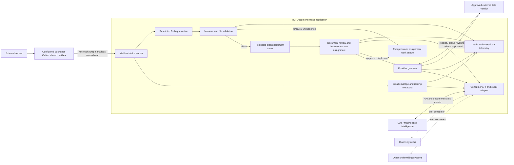

# MCI Document Intake Application — High Level Design

**Status:** Draft for business, security and architecture review  
**Date:** 2 October 2026  
**Application boundary:** A separate MCI-wide application, not a component of the CAT or Marine Risk Intelligence application  
**First consumer:** Crew CVs and qualification certificates for specialist-yacht underwriting  
**Future consumers:** Other MCI underwriting, claims and operational systems

## 1. Decision and scope

Create a standalone **MCI Document Intake application**. It owns inbound channels, attachment extraction, quarantine, malware scanning, controlled document storage, intake work queues, audit and downstream delivery. Business applications consume document references and status events through governed APIs; they do not implement mailbox access or store an uncontrolled second copy of every attachment.

The CAT / Marine Risk Intelligence application is the first consumer. A broker or yacht managing agent sends crew documents to a shared mailbox configured in the Document Intake application. The application captures each genuine file attachment as a separate, traceable document and places it in a restricted review queue. The yacht underwriting workflow supplies or confirms the risk-case and crew-person context and approves any onward transfer to a data provider.

The initial release of the separate application is intentionally narrower than a full intelligent document processing (IDP) platform:

- one dedicated shared mailbox;
- PDF, DOC/DOCX, JPEG and PNG attachments, with file types and limits configurable by security;
- one stored `DocumentAsset` for each attached file;
- preservation of the original file without altering its evidential content;
- malware, file-signature, duplication and basic metadata checks;
- a generic business-context link, with the first configuration supporting yacht risk case, crew member and document type;
- controlled download or provider hand-off with a complete audit trail; and
- no OCR, AI classification, field extraction, automatic credential decision or unattended vendor disclosure at launch.

A PDF containing several certificates remains one attachment in the initial release. Page-level document separation is a later IDP capability.

## 2. TCG reference pattern

TCG Process describes OCTOidp as a three-stage pattern: **Collect**, **Understand** and **Act**. It can accept email and shared-mailbox content, classify and extract data, use human verification, and route validated outputs to downstream systems. Its Digital Mailroom and Email Triage material also emphasises normalisation, role-based access, audit, human exception handling and Microsoft Graph mailbox connectivity.

The initial MCI implementation uses the pattern without taking on the entire product scope:

| TCG pattern | Initial MCI implementation | Later reusable capability |
|---|---|---|
| Collect | Read a configured shared mailbox; create one immutable asset per attachment; retain source metadata; scan and quarantine. | Add web upload, personal mailbox, scan, API and bulk-ingestion channels behind the same intake contract. |
| Understand | Use a consumer-system reference where supplied; require a person to confirm business context, party and document type. | Classification, OCR, extraction, confidence scores, cross-document completeness checks and human validation. |
| Act | Notify the consuming application and permit an authorised, reviewed provider hand-off. | Rules-based routing into underwriting, claims and other MCI systems, with reusable provider connectors. |

TCG/OCTO is a reference and potential buy option, not selected by this design. A build-versus-buy assessment should compare OCTO with the small Azure implementation below using representative MCI emails, documents, security requirements, volumes, integration effort, licence cost and exit/export provisions.

References: [OCTOidp](https://www.tcgprocess.com/en-en/octo/octoidp/), [TCG Digital Mailroom](https://www.tcgprocess.com/en-en/accelerator/digital-mailroom/), and [TCG Email Triage](https://www.tcgprocess.com/en-en/accelerator/email-triage/).

## 3. Initial user journey

1. The consuming business application creates or displays an intake reference and the shared-mailbox address configured for that process. For the first use, the CAT application associates the intake reference with a yacht risk case and the underwriter gives both to the broker or yacht managing agent.
2. The sender emails one or more crew CVs or qualification certificates. The preferred subject convention is `[MCI intake reference] – [yacht] – crew documents`; failure to follow it must not lose the email.
3. A mailbox intake worker reads the dedicated shared mailbox through Microsoft Graph and records the message identity, sender, subject and received time. It does not crawl users' personal mailboxes.
4. The worker enumerates attachments and creates one `DocumentAsset` per genuine file. Inline logos and signature images are ignored as documents but recorded in processing telemetry. Unsupported, encrypted, oversized, nested or malformed attachments enter an exception queue.
5. Each file is written to a restricted quarantine container, hashed and scanned. Only a clean result allows the file to move to the clean document container or become visible for preview or onward transfer.
6. The service tries only deterministic consumer-context matching at launch, using the supplied intake reference and the relevant consumer resolver API. If the reference is absent, invalid or ambiguous, the item enters **Needs assignment** in the Document Intake work queue.
7. An authorised user from the owning department reviews the clean files and confirms the consumer system, business context, party and document type. For the first use, these are the CAT yacht risk case, yacht and crew member. A single email may contain documents for several crew members.
8. The reviewer selects the intended vendor and the files to send. A second approval is configurable for medical documents, identity documents or other sensitive categories.
9. The provider connector sends the approved package by an agreed secure method and records the provider reference, time, outcome and receipt. Failure is retryable and never reported as delivered without an acknowledgement.
10. The Document Intake application publishes document references and status events to the consuming application. The yacht case shows the permitted source metadata, every linked attachment, review and dispatch status without copying the document bytes into the CAT data store or treating a vendor submission as successful verification.

## 4. Logical architecture

### Recommended implementation

- Deploy Document Intake as a separately owned application with its own Entra application identities, APIM product, compute, Service Bus namespace or topics, operational metadata and restricted document storage. It must not share the CAT application's database or deployment lifecycle.
- Configure one or more purpose-specific Exchange Online shared mailboxes. Use a Microsoft Graph application identity restricted to only the configured mailboxes. Poll each mailbox folder using Graph delta queries every two to five minutes. Persist the opaque delta link so processing can resume without rereading the whole mailbox. A Graph change notification can replace polling later if latency requires it.
- Use an Azure Function or Container Apps job as the mailbox worker and publish idempotent work to Service Bus. The identity key is mailbox ID + Graph message ID + attachment ID; an attachment SHA-256 hash provides duplicate evidence but must not erase the fact that a second email was received.
- Keep the source email in Exchange under an agreed Exchange retention policy. In the application retain only the email metadata and individual attachments needed for the business purpose; do not create an indefinite second archive of the message body.
- Use separate Blob Storage quarantine and clean containers, private endpoints, managed identity and customer-managed access policies where required. A file cannot be previewed, downloaded or dispatched until scanning returns `Clean`.
- Use the Document Intake application's Cosmos DB for operational metadata and workflow status, never the document bytes. Consuming systems store opaque `documentId` references and permitted status metadata only. A document link resolves through the authorised Document Intake API rather than exposing a permanent blob URL.
- Use APIM and a provider gateway for outbound integrations. Secrets belong in Key Vault; providers receive only explicitly approved documents and minimum necessary metadata.
- Publish a versioned consumer contract. Initial operations are `createIntakeReference`, `resolveBusinessContext`, `listDocuments`, `getAuthorisedContent`, `assignDocument`, `requestDispatch` and `getDispatchStatus`; events include `DocumentReceived`, `DocumentReady`, `AssignmentRequired`, `DocumentRejected`, `DispatchSent` and `DispatchAcknowledged`.

Microsoft documents both [incremental mailbox processing with Graph delta queries](https://learn.microsoft.com/en-us/graph/delta-query-messages) and [on-upload malware scanning for Blob Storage](https://learn.microsoft.com/en-us/azure/defender-for-cloud/introduction-malware-scanning).

## 5. Minimum records and statuses

### `EmailEnvelope`

`envelopeId`, channel configuration ID, mailbox ID, Graph message ID, internet message ID, sender, recipients, subject, received time, supplied/detected intake reference, attachment count, correlation ID, processing status and retention date.

### `DocumentAsset`

`documentId`, `envelopeId`, original filename, declared and detected media type, size, SHA-256, restricted storage reference, scan status, generic document type, assignment confidence/method, received time, review status and retention class. Consumer-specific case, yacht, crew or claim fields do not belong in this record.

### `BusinessContextLink`

`linkId`, `documentId`, consumer system, context type, opaque context ID, optional party type/ID, consumer document type, link status, resolver result, confirmed by/at and effective retention profile. This keeps the central application reusable without teaching it the data model of every consuming system.

### `ProviderDispatch`

`dispatchId`, requesting consumer, provider, business-context link IDs, document IDs, purpose, requested by/at, approved by/at, delivery method, status, attempts, provider reference/receipt and failure reason. Documents in one dispatch must belong to the same confirmed party and purpose unless the provider contract explicitly supports a different package.

### Status flow

`Received → Quarantined → Clean → Needs assignment → Ready for review → Approved → Sent → Acknowledged`

Terminal or exception states include `Malware detected`, `Unsupported`, `Rejected`, `Duplicate noted`, `Delivery failed` and `Retention expired`. A duplicate is not silently discarded; the second receipt remains auditable and may link to the existing bytes where policy permits.

## 6. Provider hand-off

Crewdentials is a candidate, not an assumed integration. Its public developer material currently describes APIs for creating and retrieving crew, contracts and signed update webhooks. It does not document a file-upload endpoint. MCI must obtain and review the vendor's current API specification, authentication method, document-upload capability, data locations, sub-processors, retention/deletion behaviour, incident terms and controller/processor position before automating document transfer.

The standalone application's provider gateway exposes a stable internal contract while allowing different delivery methods. The consuming department owns the business decision and requests disclosure; Document Intake enforces the technical controls and performs the delivery:

1. **Launch fallback:** an authorised user downloads a recorded, clean export package and uploads it to the vendor's approved portal. The dispatch record remains `Exported for manual upload` until the user records the vendor reference.
2. **Preferred automation:** direct API submission with an idempotency key and positive provider receipt.
3. **Not a default:** forwarding attachments by ordinary email. This requires explicit security and data-protection approval and must not be used merely because an API is absent.

Crewdentials reference: [public developer documentation](https://www.crewdentials.com/resources/developers).

## 7. Security and data-protection controls

- Treat every attachment as untrusted. Enforce allowed types using file signatures as well as extensions; block active content; quarantine archives, nested emails, password-protected files and malformed documents for manual handling.
- Apply Exchange malware controls and independent storage scanning. Never rely on the sender, filename or email scan alone.
- Restrict mailbox access to the intake identity and configured mailboxes. Segregate documents by department, purpose, business context and role; access granted in CAT, claims or another consumer must not automatically grant unrestricted access in Document Intake.
- Crew CVs, identity documents, certificates and medical evidence are personal information. Record purpose, lawful basis, source, recipients, retention and deletion. Store only the minimum structured facts needed; a medical certificate should normally yield validity/fitness status rather than diagnostic details.
- Encrypt in transit and at rest, use private network paths where practical, disable public blob access, and issue only short-lived authorised download streams.
- Audit receipt, scan, preview, download, assignment, reclassification, approval, disclosure, provider receipt, correction and deletion. Logs must not contain document bodies or unnecessary personal data.
- Define sender-error, wrong-recipient, data-subject-access, correction, deletion, legal-hold and provider-recall procedures before production.
- Do not use documents for AI training, secondary analytics or another insurance process without an approved purpose and governance decision.

## 8. Initial acceptance criteria

- An email with three supported attachments creates one envelope and three separately identifiable document assets.
- Retrying the same Graph message does not create extra records or resend documents.
- Inline signature images do not appear as crew documents; unsupported or unsafe content is visible in an exception queue and cannot be opened from the case.
- No attachment is previewable, downloadable or dispatchable before a clean malware result.
- A valid intake reference links the envelope to an opaque consumer context, but a user must still confirm the party and document type before dispatch.
- Missing or ambiguous references create a work item and never cause automatic attachment to the nearest-looking case or person.
- The reviewer can select only clean, reviewed files and sees the provider, purpose and minimum metadata before approving disclosure.
- The Document Intake application records each file's hash, source email, consumer context, reviewer, approver, recipient provider, delivery outcome and provider reference.
- A failed vendor call is retryable and cannot produce a false `Sent` or `Verified` state.
- Users can distinguish `Received`, `Sent to provider`, `Provider acknowledged` and `Credential verified`; none implies another.
- Retention expiry removes or anonymises content according to policy while preserving the minimum permitted audit evidence.

## 9. Application ownership and reuse

Document Intake is a separate product with a central MCI owner, service support, security model, release lifecycle and roadmap. Configure mailbox/channel, allowed document types, business-context resolver, retention class, reviewers and outbound destination per consuming process. Do not introduce CAT, yacht, claims or policy-specific fields into the generic `EmailEnvelope` or `DocumentAsset` records.

The CAT application owns yacht cases, crew-person identities, underwriting workflow and the decision to request a provider disclosure. Document Intake owns receipt, safe storage, generic work queues, delivery and evidence of delivery. A later claims configuration reuses the same lifecycle while applying its own mailbox, claim-reference resolver, taxonomy, access roles, retention and downstream connector. Cross-department access is denied by default even when both departments use the same platform.

The expansion decision should be evidence-led. Add OCR, AI classification or automated field extraction only when MCI has labelled representative documents, agreed accuracy/error measures, defined human-review thresholds and proven that the added automation saves enough work to justify its risk and cost.

## 10. Decisions required before build

1. Central product owner, funding, support model and service-level objectives for the MCI-wide application.
2. Shared mailbox addresses, departmental operational owners, monitored hours and sender acknowledgement wording.
3. Generic intake-reference format, consumer resolver contract and ownership of `Needs assignment` and exception queues.
4. Allowed file types, per-file/message size, encrypted-document handling and retention profiles by business purpose.
5. Identity propagation and authorisation between Document Intake and each consuming application, including which roles can view, assign and approve disclosure.
6. Whether sensitive categories require four-eyes approval.
7. Crewdentials or alternative provider contract, upload interface, test environment, receipt/status semantics and deletion obligations.
8. Whether MCI will build the standalone Azure application or procure TCG/OCTO after a representative proof of value.
9. Expected daily and catastrophe/event peak volumes across departments, target intake latency, capacity allocation and cost model.

